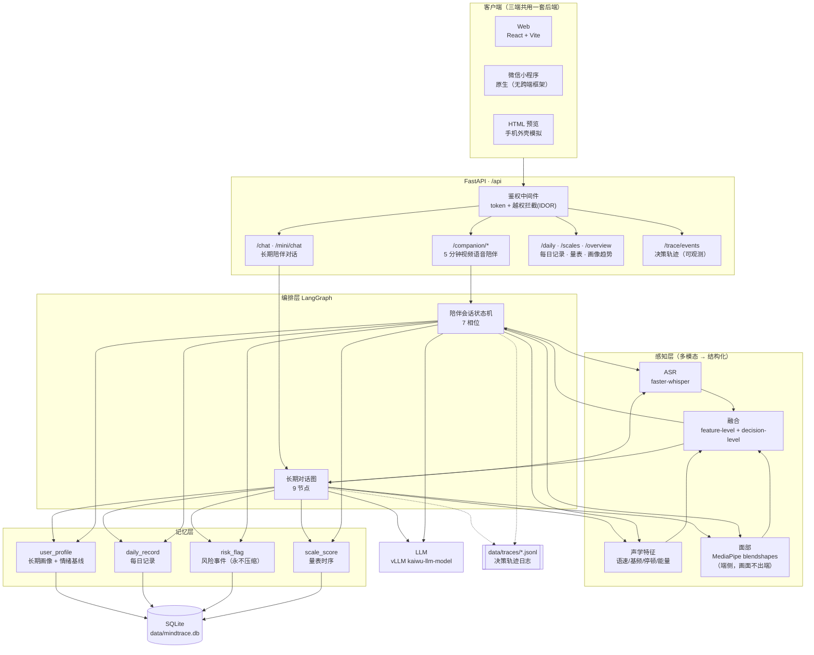
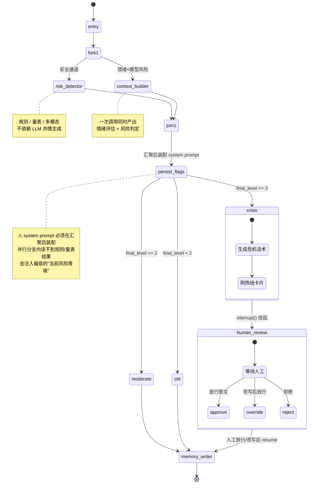
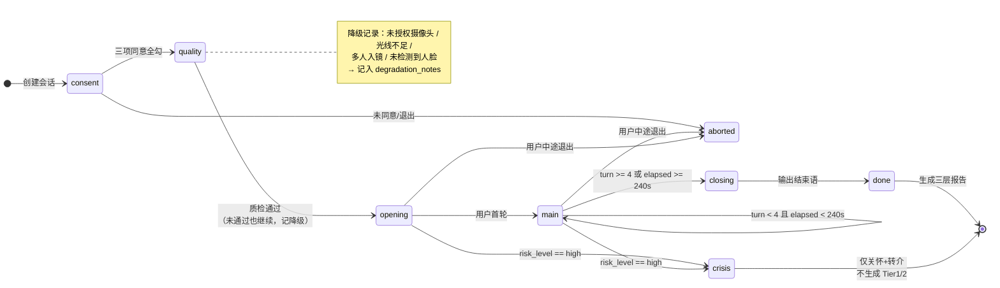
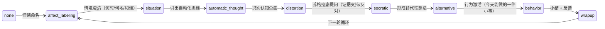
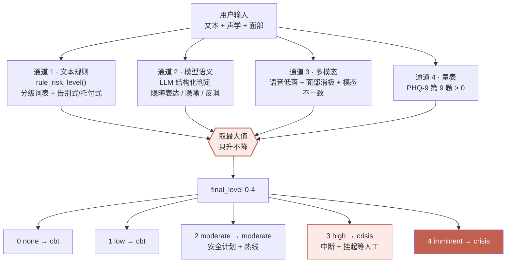
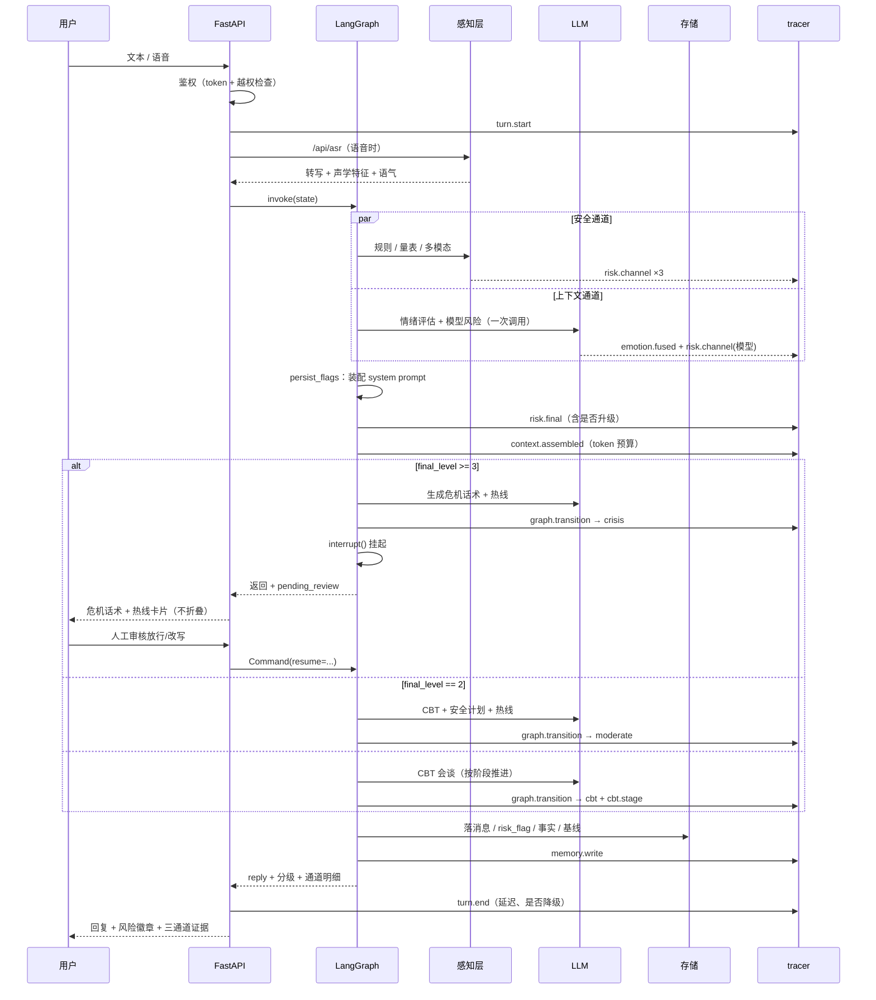
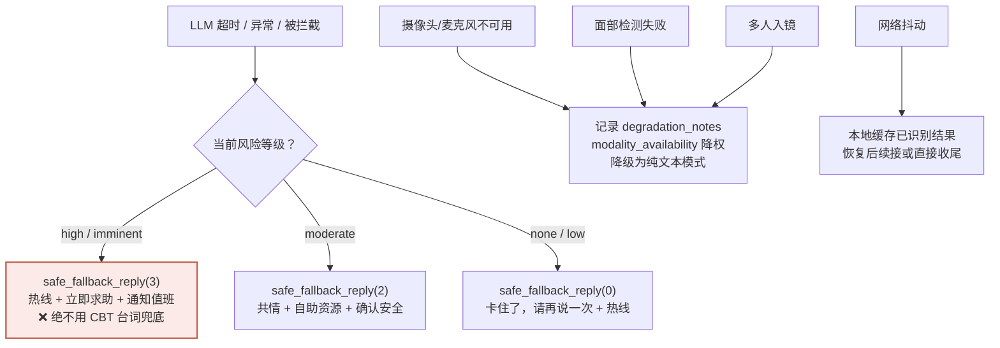

# MindTrace Agent 架构与状态转移全图

> 本文所有图均按**代码实际结构**绘制，非示意图。
> 对应源码：`backend/graph.py`（长期对话图）、`backend/companion/state.py`（陪伴会话）、
> `backend/graph_state.py`（CBT 阶段）、`backend/perception.py` + `companion/fusion.py`（风险与情绪）。

---

## 1. 系统总览



**关键约束**：原始音视频**不入库、不进 LLM 上下文**。感知层只产出结构化指标（PRD §8 数据最小化）。

---

## 2. 长期对话：LangGraph 状态图

`backend/graph.py :: build_graph()`



### 2.1 节点职责

| 节点 | 职责 | 是否调 LLM |
|---|---|---|
| `entry` | 载入画像、量表趋势、多模态摘要、风险历史、风险趋势、近期陪伴 | 否 |
| `risk_detector` | 规则 + 量表 + 多模态三通道（**独立于生成**） | 否 |
| `context_builder` | 情绪评估 + 模型风险通道（一次结构化调用） | 是 |
| `persist_flags` | **汇聚后**装配 system prompt、落用户消息、落 risk_flag | 否 |
| `crisis` | 危机协议：不追问、给热线、通知人工 | 是 |
| `human_review` | `interrupt()` 挂起等人工 | 否 |
| `moderate` | CBT + 安全计划 + 热线 | 是 |
| `cbt` | CBT 会谈，按阶段推进 | 是 |
| `memory_writer` | 事实抽取、滚动摘要、消息落库、写审计 | 每 N 轮 |

### 2.2 为什么这样切分

1. **风险检测与对话生成架构解耦**：共情模型被优化为"维持关系、避免冒犯"，与"保守报警"目标冲突。独立通道可单独调阈值、单独评测、单独审计。
2. **并行分支有陷阱**：`context_builder` 内读到的 state **不含**规则/量表/多模态结果。若在此装配 system prompt，注入的等级会偏低 —— 高危场景是致命的。所以装配必须放到 `persist_flags`。
3. **`crisis` → `human_review` 是强制边**：high 及以上不做自动化闭环。

---

## 3. 陪伴会话：Phase 状态机

`backend/companion/state.py :: SessionState.next_phase()`



### 3.1 时间与轮次常量

| 常量 | 值 | 作用 |
|---|---|---|
| `TARGET_TOTAL` | 300s | 目标总时长 5 分钟 |
| `WRAP_UP_AT` | 240s | 4:00 触发收尾提醒（追加过渡句，不硬掐断） |
| `HARD_LIMIT` | 330s | 5:30 硬上限，强制结束 |
| `SILENCE_PROMPT` | 8s | 静默 8s 轻声确认"不着急，你可以慢慢说" |
| `IDLE_CONFIRM_AT` | 60s | 静默 60s 确认"看到你很久没回复了，这次先聊到这里吗" |
| `IDLE_END_AT` | 90s | 上一步后再等 30s 仍无回复 → 结束话术 + `action=end` |
| `MIN_TURNS` | 3 | 主体建议轮次（报告完整性提示，**非终止条件**） |

> **已废弃 `MAX_TURNS`（原"满 4 轮进入结束语"）**：轮次与用户是否想结束无关，
> 现在 `main → closing` 只由累计时长（≥240s）或静默阶梯（≥90s）触发。

> 沉默时间**不计入"对话时长"**（否则用户思考会被扣时间），但计入总墙钟时间。

---

## 4. CBT 阶段流转

`backend/graph_state.py :: CBT_NEXT`



**约束**：追问深度**不超过两层**（PRD §6.2），避免 5 分钟内话题过散、造成压迫感。

---

## 5. 风险判定：三通道并集



**为什么取最大值**：宁误报不漏报。漏报是红线缺陷，误报只是多问一句。

> ⚠ 曾修过两个真实缺陷，都在这条链路上：
> 1. `RISK_PATTERNS_IMPLICIT`（告别式/托付式）**从未被遍历** —— config 里定义了但 `rule_risk_level()` 没读，导致"以后不用管我了""帮我把东西转交"完全漏判。
> 2. `face_emotion` 归一化除以"命中个数"而非"权重总和"，导致规则多、命中全的类别被稀释（明显低落被判成焦虑）。

---

## 6. 一次长期对话的完整时序



---

## 7. 降级与兜底（红线）



**安全性 vs 活性**（LTS 语义）：

| 类型 | 含义 | 本项目约束 |
|---|---|---|
| **安全性**（不变量 □P） | 任何时刻不得违反 | 风险话不进摘要管道；high 必挂起；不输出自杀方法；不输出诊断 |
| **活性**（最终进展 ◇Q） | 最终必须往前走 | 危机分支必给热线；每轮必有分级；5:30 必收尾；沉默 8s 必响应；LLM 失败必给兜底 |

> 只做安全护栏而不做降级兜底，会产出一个"什么都不敢说"的 Agent —— 它满足所有不变量，却在用户最需要回应时沉默。

---

## 8. 可观测层（tracer）

```
data/traces/agent-YYYYMMDD.jsonl      # JSONL，一行一事件
```

| 事件 | 内容 |
|---|---|
| `turn.start` / `turn.end` | 轮次边界、延迟、字数、危机/降级标记 |
| `emotion.channel` / `emotion.fused` | 各模态原始判断 → 融合结果 |
| `risk.channel` / `risk.final` | 三通道 → 并集（升级打 ⚠） |
| `graph.transition` | 节点跳转 + 条件 + 原因 |
| `phase.transition` | 陪伴会话相位推进 |
| `cbt.stage` | CBT 阶段推进 |
| `context.assembled` | token 预算占用 |
| `memory.write` | 事实条数、情绪基线 |

实时查看：

```bash
tail -f data/traces/*.jsonl | python3 -c "
import sys, json
for l in sys.stdin:
    e = json.loads(l); print(e['ts'][11:23], e['kind'].ljust(18), e['msg'])
"
```

界面查看：Web 顶部 **「决策轨迹」** tab。
