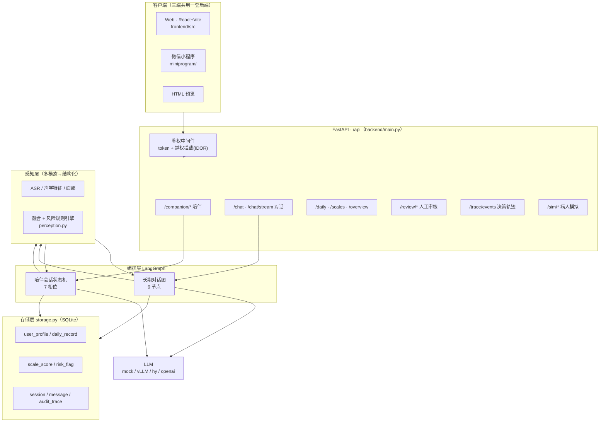
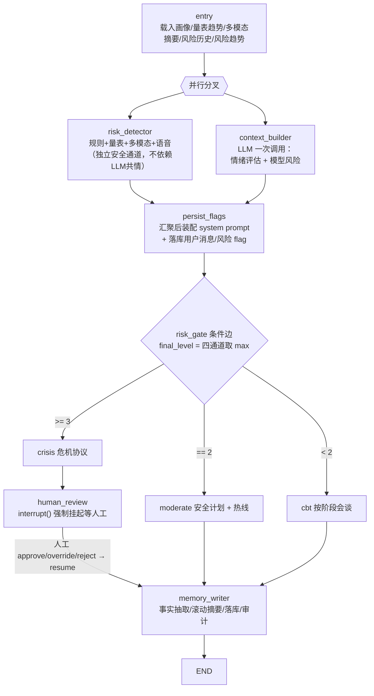
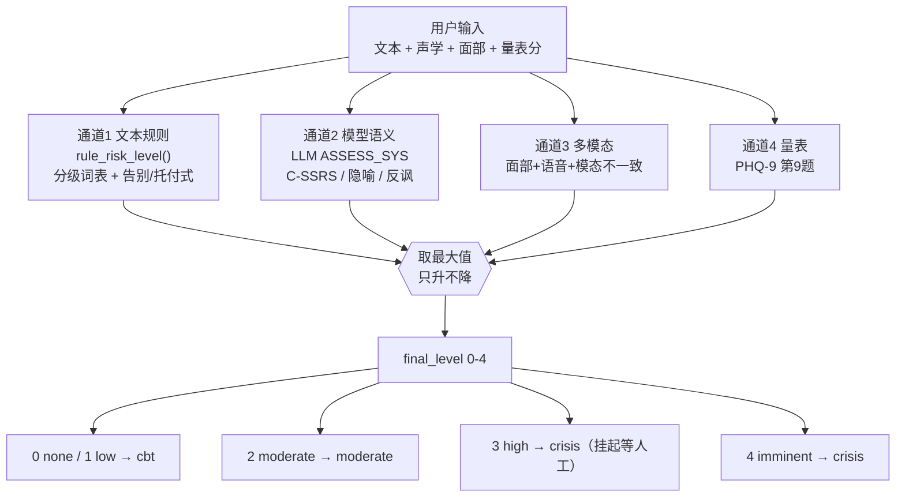
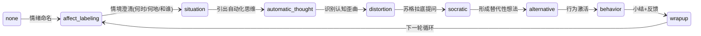
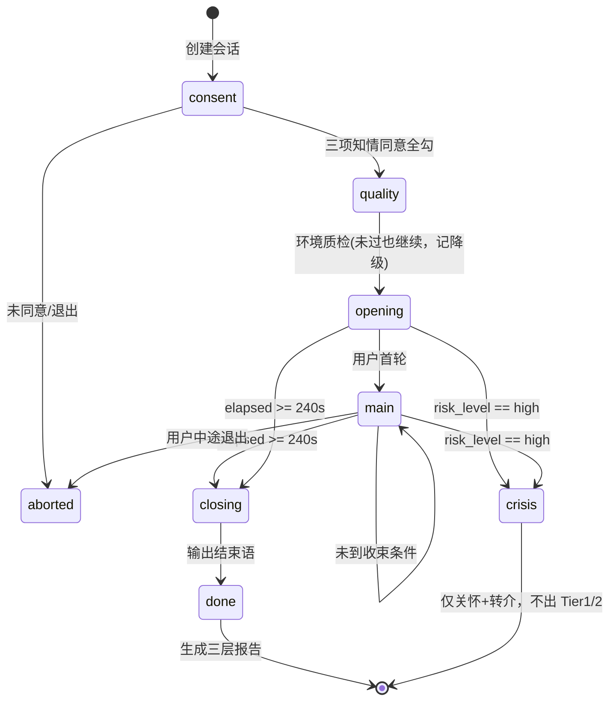
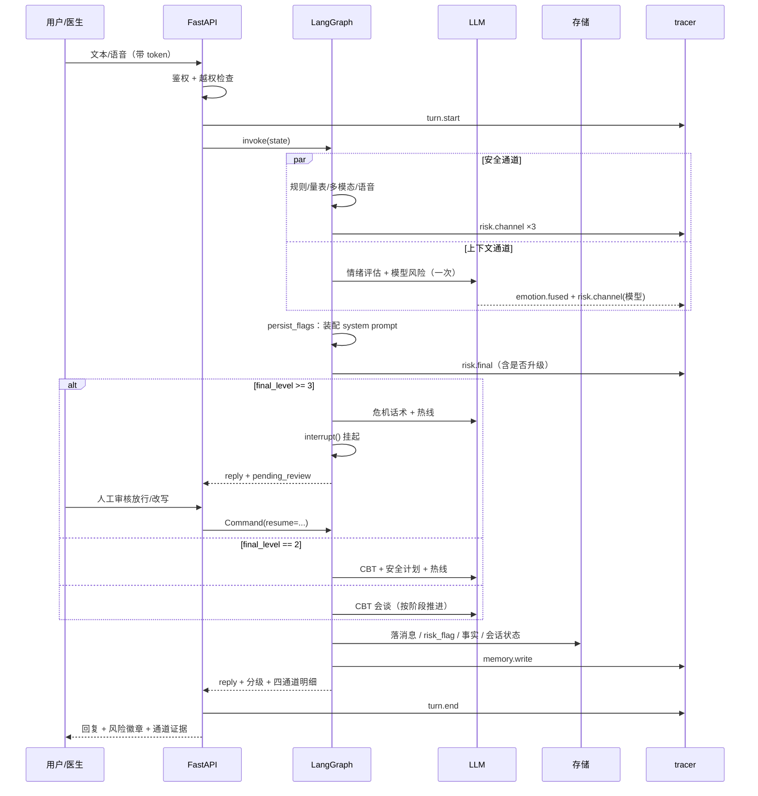
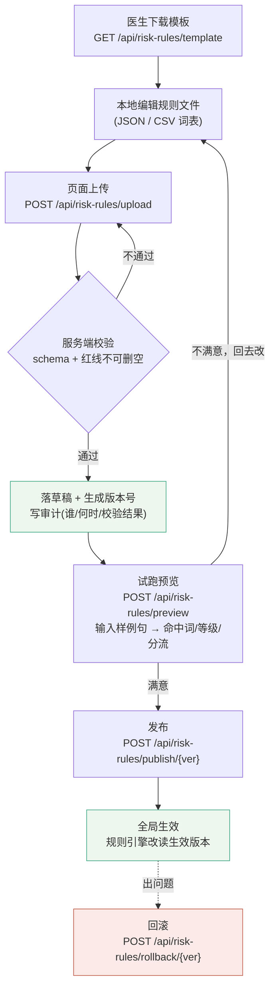
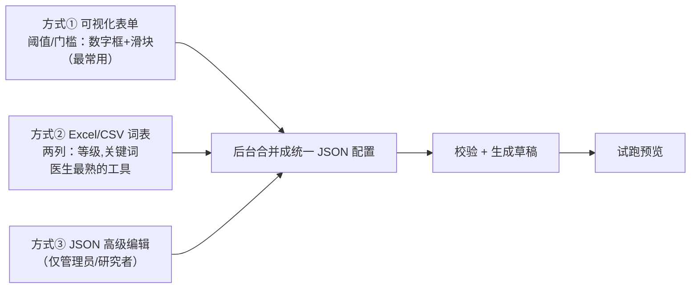

# 流程框架梳理 · 医生体验与风险规则配置化方案

> **文档状态**：流程梳理 + 设计方案；**P0（配置上传/试跑闭环）与 P1（引擎接入 + 可视化调参）均已落地**（见第 6 章 6.1 / 6.2）；P2 待后续。
> ⚠ P1 之后本文 5.5 / 6.1 / 7 中「引擎尚未接入」的描述均为**历史记录**，以 6.2 为准。
> 本文所有流程与状态条件均按 `main` 分支**代码实际结构**绘制，非示意图。
> 对应源码：`backend/graph.py`（长期对话图）、`backend/companion/state.py`（陪伴会话）、
> `backend/graph_state.py`（CBT 阶段）、`backend/perception.py` + `backend/config.py`（风险与情绪）、
> `backend/main.py`（API）、`frontend/src/App.jsx`（页面）。
>
> 相关既有文档：`docs/architecture_flow.md`（架构与数据流全图）、`docs/情绪识别陪伴Agent_PRD_2.md`（PRD）。

---

## 0. 本文档要回答的三个问题

1. **整个流程框架是什么，状态轮转的条件有哪些？** → 第 2 章。
2. **如何暴露一个网页端接口给医生体验？** → 第 3 章现状 + 第 4 章方案（复用现有页 + 医生向导）。
3. **风险判断规则能否配置化、边配置边体验？** → 第 3 章现状 + 第 5 章方案（页面上传 + 试跑预览）。

**已确认的取向**（来自需求方）：
- 先完成梳理与设计文档，随后**先落地 P0**（配置上传/试跑最小闭环）。
- 体验形态：**复用现有页面**，不新建大页面；配置卡片挂在「人工审核台」页顶部。
- 配置化：**页面上要有地方能让医生上传配置**（文件是配置入口）。
- 「生效方式」按推荐默认值实现：草稿 + 发布两步（P0 的发布先做版本标记，引擎接入留到 P1）。

---

## 1. 系统总览



**关键约束**
- 原始音视频**不入库、不进 LLM 上下文**，感知层只产出结构化指标（PRD §8 数据最小化）。
- `data/`（主库 `mindtrace.db`、checkpoints、traces）已在 `.gitignore`，**永不入库**，心理数据属敏感个人信息。
- 存储层与编排层**解耦**：业务数据走自己的 SQL 表，LangGraph 的 checkpoint 只管会话状态机，便于将来换框架。

---

## 2. 流程框架与状态轮转条件（核心）

系统里其实有**三套状态机 + 一条风险并集链路**。下面逐一给出「进入/流转条件」。

### 2.1 长期对话 LangGraph 图（9 节点，主链路）

`backend/graph.py :: build_graph()`（`graph.py:698-729`）



**节点职责**（`graph.py:698-728`、架构文档 §2.1）

| 节点 | 职责 | 调 LLM |
|---|---|---|
| `entry` | 载入画像、量表趋势、多模态摘要、风险历史、风险趋势、近期陪伴 | 否 |
| `risk_detector` | 规则 + 量表 + 多模态（+语音语气）四通道，**独立于生成** | 否 |
| `context_builder` | 情绪评估 + 模型风险通道（一次结构化调用） | 是 |
| `persist_flags` | **汇聚后**装配 system prompt、落用户消息、按证据去重落 `risk_flag` | 否 |
| `crisis` | 危机协议：不追问、给热线、通知人工 | 是 |
| `human_review` | `interrupt()` 挂起等人工 | 否 |
| `moderate` | CBT + 安全计划 + 热线 | 是 |
| `cbt` | CBT 会谈，按阶段推进 | 是 |
| `memory_writer` | 事实抽取、滚动摘要、消息落库、写审计 | 每 N 轮 |

### 2.2 状态轮转的唯一依据：`final_level`

图的分流**只看一个值**——`final_level(state)`（`graph.py:316-324`）：

```
final_level = max(
    risk_level,                 # 历史累积（keep_max reducer，只升不降）
    risk_rule.level,            # 通道1 文本规则
    risk_model.level,           # 通道2 模型语义
    risk_multimodal.level,      # 通道3 多模态+语音
    risk_scale.level,           # 通道4 量表
)
```

> ⚠ 文档口径不一致：`README` 与架构文档 §2 标题写「三通道」，但代码 `final_level()` 明确是**四通道**。以代码为准。
> `risk_level` 字段带 `keep_max` reducer（`graph_state.py:18-20`），保证**并集升级、只升不降**。

**条件边 `risk_gate`**（`graph.py:294-313`）：

| `final_level` | 分流目标 | 处理 |
|---|---|---|
| `>= 3`（high / imminent） | `crisis` | 危机话术 + 热线 → **强制**挂起等人工 |
| `== 2`（moderate） | `moderate` | CBT + 安全计划 + 热线 |
| `0 / 1`（none / low） | `cbt` | 常规 CBT 会谈 |

**强制边**：`crisis → human_review` 无条件（`graph.py:724`）。high 及以上**绝不自动化闭环**，必须 `interrupt()` 挂起，由 `/api/review` 决定 `approve / override / reject` 后 `resume` 才能到 `memory_writer`。

### 2.3 四通道风险判定（这就是「中间判断风险的规则」）



**等级映射**（`config.py:132`）：`0 none / 1 low / 2 moderate / 3 high / 4 imminent`，中文标签见 `models.py:17-23`（无/轻度/中度/重度/危急）。

| 通道 | 代码位置 | 当前规则来源 | 触发条件（现状） |
|---|---|---|---|
| 规则 | `perception.py:260-284` | `config.py` 词表 `RISK_PATTERNS_*` | 按 `imminent→high→moderate→low→implicit` 顺序匹配，**首个命中**即返回该级 |
| 模型 | `graph.py:82-108` `ASSESS_SYS` | 硬编码 prompt（C-SSRS） | LLM 结构化输出 `risk_level` 等字段 |
| 多模态 | `perception.py:308-329`、`349-391` | 函数内硬编码阈值 | 面部悲伤>0.6→2；负面词≥4→1；失眠+语速显著下降→1；掩饰信号→2；模态不一致→1 |
| 量表 | `perception.py:97-110` | `PHQ9_SUICIDE_ITEM_INDEX=8` | PHQ-9 第9题：1→low / 2→moderate / 3→high |

**规则通道词表**（`config.py:135-166`）：

- `RISK_PATTERNS_IMMINENT`（4）：正在 / 已经吃了 / 在天台 / 手腕已经 / 最后一次 …
- `RISK_PATTERNS_HIGH`（3）：写遗书 / 遗嘱 / 安排后事 / 把东西都送人 / 想好怎么死 …
- `RISK_PATTERNS_MODERATE`（2）：想自杀 / 想死 / 结束生命 / 不想活了 / 轻生 …
- `RISK_PATTERNS_LOW`（1）：活着没意思 / 我是负担 / 拖累别人 …
- `RISK_PATTERNS_IMPLICIT`（按 2 起判，弱信号）：以后不用管我了 / 帮我把东西转交 / 最后一次说 …（由模型通道决定是否升到 high）

### 2.4 CBT 阶段轮转

`backend/graph_state.py :: CBT_NEXT`（`graph_state.py:146-156`），仅在低风险 `cbt` 分支**每轮推进一步**：



约束：追问深度不超过两层（PRD §6.2）。

### 2.5 陪伴会话 Phase 状态机（5 分钟视频语音）

`backend/companion/state.py :: SessionState.next_phase()`（`state.py:98-110`）



**轮转条件**：

| 条件 | 阈值（`state.py:20-27`） | 行为 |
|---|---|---|
| 风险升级 | `risk_level == "high"` | 直接转 `crisis`（陪伴侧仅 none/watch/high 三档） |
| 收尾提醒 | `elapsed >= WRAP_UP_AT`（240s） | 追加过渡句，不硬掐断 |
| 硬上限 | `elapsed >= HARD_LIMIT`（330s） | 强制结束 |
| 静默阶梯 | 8s 轻提示 / 60s 确认是否结束 / 90s 收尾 | `silence_check()` 驱动 |

> **轮次不再作为终止条件**：`MAX_TURNS`（原「满 4 轮进入结束语」）已废弃；沉默时间不计入对话时长，但计入总墙钟时间。

### 2.6 几条必须记住的设计约束

1. **风险检测与对话生成架构解耦**：共情模型被优化为「维持关系/避免冒犯」，与「保守报警」目标冲突，故独立安全通道。
2. **并行分支陷阱**：`context_builder` 与 `risk_detector` 并行，彼此读不到对方结果。system prompt **只能在汇聚节点 `persist_flags` 装配**，否则注入的「当前风险等级」偏低（高危场景致命）。
3. **只升不降**：`risk_level` 带 `keep_max` reducer；`final_level` 再次取 max，双重保证。
4. **人在回路**：high/imminent 必挂起，不做自动化闭环。
5. **幂等键**：`persist_flags` 用 `_persisted_turn` / `_traced_turn` 防危机/中度分支二次调用重复落库（`graph.py:348-394`）。
6. **模型挂了也不静默**：危机/中度分支若用 mock 或降级，一律换成 `safe_fallback_reply()` 热线兜底，绝不发 CBT 台词（`graph.py:446-511`）。

### 2.7 一次长期对话的完整时序



---

## 3. 现状盘点（与两个需求直接相关）

### 3.1 医生体验「已有」的能力

前端 `App.jsx:14-23` 已有 **8 个 tab**：视频语音陪伴 / 对话 / 每日记录 / 量表 / 画像与趋势 / 人工审核台 / 上下文装配 / 决策轨迹。

| 能力 | 现状 | 入口 |
|---|---|---|
| 登录鉴权 | token + 越权拦截（`main.py:80-141`）；账号 `demo/demo1234` | 登录页 |
| 病人模拟 | `/api/sim/*`（`main.py:280-341`），医生不用手打危机话术即可看到「升级→挂起」 | **对话页右侧栏**「🧪 病人模拟」卡片（`ChatView.jsx:363-429`） |
| 实时四通道判定 | 每轮返回 `channels` / `final_level` / 证据 | 对话页右侧栏「本轮实时判定 / 三通道检测」 |
| 人工审核闭环 | `/api/review`、`/api/review/pending`、`/api/risk/{id}/handle` | 对话页挂起卡片 + 「人工审核台」tab（`ReviewView.jsx`） |
| 决策可观测 | `/api/trace/events`（tracer 事件流）、`/api/traces/{sid}` | 「决策轨迹」tab、「上下文装配」tab |
| SSE 流式 | `/api/chat/stream` 先推风险元数据再逐字推正文 | 对话页 |

**结论**：医生体验的「底座」基本齐全，**缺的不是接口，而是把这些散落在对话页侧栏、审核台、决策轨迹三处的能力串成一条引导路径**。

### 3.2 风险规则「当前」放哪（配置化要动的地方）

| 规则 | 位置 | 形态 |
|---|---|---|
| 分级关键词表 | `config.py:135-166` | Python 常量 `RISK_PATTERNS_*` |
| 文本正负向词表 | `config.py:176-183` | `POSITIVE_WORDS` / `NEGATIVE_WORDS` |
| 情绪关键词映射（mock 兜底） | `config.py:189-202` | `EMOTION_KEYWORD_MAP` |
| 语速阈值 | `config.py:210-211` | `SLOW_SPEECH_*` |
| 量表风险硬触发 | `perception.py:59,97-110` | `PHQ9_SUICIDE_ITEM_INDEX` + `if/else` |
| 多模态/语音阈值 | `perception.py:308-391` | 函数内硬编码（悲伤>0.6、负面词≥4 等） |
| 危机热线 | `config.py:114-118` | `hotline_*` |

> `config.py` 文件头注释本就写明：*「所有与安全相关的常量…生产环境应改为从数据库/配置中心读取，避免硬编码在 prompt 里」*。
> 因此「规则配置化」与项目既定方向一致，本方案把它落成**可上传、可试跑、可发布、可回滚**的闭环。

---

## 4. 需求二方案：医生网页体验（复用现有页 + 医生向导）

**取向**：不新建大页面。新增一个**「医生向导」组件**（如 `DoctorGuide.jsx`），叠加在现有 `App.jsx` 顶部/侧边，以「步骤条」形式引导医生按链路体验，每步点击即切到对应现有 tab，并提示「这一步看什么」。

### 4.1 向导步骤（串联现有页）


| 步骤 | 落在哪个现有页 | 医生要观察的点 |
|---|---|---|
| ① 配置 | 「人工审核台」页**顶部新增一张「风险规则配置」卡片**（面向专业人员，语义最贴合） | 上传规则文件 → 试跑样例句 → 看命中/分级 |
| ② 对练 | 「对话」页右侧栏「🧪 病人模拟」 | 选风格 + 严重程度，跑 1/N 轮 |
| ③ 判定 | 「对话」页右侧栏「本轮实时判定 / 三通道检测」 | 四通道证据、`final_level`、是否升级 |
| ④ 轨迹 | 「决策轨迹」tab | `graph.transition` 的分流条件与原因 |
| ⑤ 闭环 | 「对话」页挂起卡片 + 「人工审核台」tab | `approve / override / reject` 与处理留痕 |

### 4.2 医生向导组件要点

- 顶部一条可折叠的「医生模式」向导条；未登录/非医生时不显示或只读。
- 每步一个按钮：「去这一步」→ `setTab(key)` 切到对应页；步骤条显示完成状态。
- 提供「一键演示」：自动新建会话 → 用 `sim` 跑 `severity=5` 若干轮 → 触发 high 挂起 → 跳到审核台，让医生 30 秒看完升级+挂起+审核闭环。
- 与现有 `overview` / `liveRisk` / `refresh` 复用同一套数据流，不额外造数据。

### 4.3 需要补的一块：角色

当前账号体系是**演示级**（`auth.py` 顶部安全说明），无角色概念，注册即用。若要「只给医生」：
- 在 `app_user` 增 `role` 字段（`patient / doctor / admin`），登录 token 携带角色；
- 医生向导、配置上传/发布接口做角色校验；
- 本阶段可先用环境变量列出「医生账号白名单」作为最小实现。

### 4.4 复用清单（本方案**不**改的）

`/api/chat`、`/api/chat/stream`、`/api/sim/*`、`/api/review/*`、`/api/trace/events`、`/api/overview/*` 等既有接口全部沿用；只在前端加向导组件 + 一张配置卡片，后端按需加一个聚合接口 `GET /api/doctor/guide-state`（可选）。

---

## 5. 需求三方案：风险规则配置化（页面上传 + 边配边试）

**取向**：配置的**入口是「页面上传文件」**。医生在本地改好规则文件 → 网页上传 → 服务端校验 → 生成草稿 → 页面里输入样例句试跑 → 满意后发布生效 → 可回滚。

### 5.1 总体流程



### 5.2 配置文件格式（上传什么）

**主格式 JSON**（覆盖词表 + 阈值），前端提供**模板下载**，医生在模板上改；另支持 **CSV 词表**（两列：`等级,关键词`）便于医生用 Excel 维护后上传。

推荐 JSON schema（示例，值为当前代码默认）：

```json
{
  "version": "1.0.0",
  "note": "由医生上传；imminent/high 词表不得删空",
  "levels": ["none", "low", "moderate", "high", "imminent"],
  "patterns": {
    "imminent": ["正在", "马上就", "已经吃了", "在天台", "准备好了一切", "最后一次"],
    "high":     ["写遗书", "遗嘱", "安排后事", "把东西都送人", "想好怎么死"],
    "moderate": ["想自杀", "想死", "结束生命", "不想活了", "轻生"],
    "low":      ["活着没意思", "我是负担", "拖累别人", "没意义"],
    "implicit": ["以后不用管我了", "帮我把东西转交", "最后一次说"]
  },
  "implicit_level": 2,
  "scale": {
    "PHQ9_SUICIDE_ITEM_INDEX": 8,
    "item_level_map": { "1": 1, "2": 2, "3": 3 }
  },
  "multimodal": {
    "enable": true,
    "sad_ratio_threshold": 0.6,
    "sad_ratio_level": 2,
    "negative_words_min": 4,
    "slow_speech_syllable_rate": 1.67,
    "slow_speech_words_per_min": 100,
    "mask_signal_level": 2,
    "inconsistency_level": 1
  },
  "voice": {
    "f0_std_flat": 15,
    "rate_slow": 3.0,
    "pause_high": 0.55
  },
  "gates": {
    "crisis_min_level": 3,
    "moderate_level": 2
  }
}
```

CSV 词表（可选，二选一上传即可）：

```csv
等级,关键词
imminent,正在
imminent,在天台
high,写遗书
moderate,想死
low,活着没意思
implicit,以后不用管我了
```

### 5.3 存储设计（上传文件 + 版本表 + 审计）

兼顾「可上传/可下载/可归档」与「合规审计」：

- **文件内容**：落盘到 `data/risk_rules/risk_rules_v{版本号}_{时间戳}.json`（`data/` 已被 gitignore，不入库）。
- **版本元数据**：在 `storage.py` 的 `DDL` 新增两张表（沿用现有 SQLite/WAL 机制）：

```sql
CREATE TABLE IF NOT EXISTS risk_rule_version(
  id INTEGER PRIMARY KEY AUTOINCREMENT,
  version TEXT NOT NULL,            -- 语义版本，递增
  file_path TEXT NOT NULL,          -- 落盘路径
  content_json TEXT NOT NULL,       -- 配置内容快照（便于比对/回放）
  status TEXT NOT NULL,             -- draft | published | rolled_back
  validation TEXT DEFAULT '',       -- 校验结果（错误/警告）
  uploaded_by TEXT DEFAULT '',      -- 上传者（医生账号）
  created_at TEXT DEFAULT ''
);
CREATE TABLE IF NOT EXISTS risk_rule_audit(
  id INTEGER PRIMARY KEY AUTOINCREMENT,
  version TEXT, action TEXT,        -- upload | publish | rollback | preview
  actor TEXT DEFAULT '', note TEXT DEFAULT '', ts TEXT DEFAULT ''
);
```

- **当前生效指针**：可放在 `risk_rule_version` 里 `status='published'` 的最新一条，或单独一张 `kv_config` 表存 `active_version`。引擎启动时加载生效版本到内存。

### 5.4 接口清单（新增到 `main.py`，均带鉴权）

| 方法 | 路径 | 说明 |
|---|---|---|
| GET | `/api/risk-rules/template` | 下载 JSON / CSV 模板 |
| POST | `/api/risk-rules/upload` | multipart 上传配置文件 → 校验 → 落草稿、生成版本、写审计 |
| GET | `/api/risk-rules` | 当前生效配置 + 草稿状态 + 版本历史 |
| GET | `/api/risk-rules/versions` | 版本列表（含 status / 上传者 / 校验结果） |
| POST | `/api/risk-rules/preview` | **边配边试核心**：传入样例文本（+可选特征/版本），返回命中词、各通道等级、`final_level`、分流目标；**不落库、不写画像、不进审核队列** |
| POST | `/api/risk-rules/publish/{version}` | 发布某草稿版本为全局生效 |
| POST | `/api/risk-rules/rollback/{version}` | 回滚到指定历史版本 |
| GET | `/api/risk-rules/active` | 当前生效版本内容（供前端展示/审计） |

`preview` 返回示例（前端据此实时渲染）：

```json
{
  "text": "我已经写好遗书了，以后不用管我了",
  "rule_hit": { "pattern": "写好遗书", "level": 3 },
  "channels": {
    "rule": { "level": 3, "evidence": "写好遗书" },
    "model": { "level": 0, "evidence": "" },
    "multimodal": { "level": 0, "evidence": "" },
    "scale": { "level": 0, "evidence": "" }
  },
  "final_level": 3,
  "route": "crisis",
  "would_interrupt": true
}
```

### 5.5 引擎改造点（读动态配置，草稿/生效分离）

把硬编码改成「从配置层读」，`perception.py` 暴露一个可选的 `config` 参数：

- `rule_risk_level(text, cfg=None)`：`cfg=None` 时读**生效版本**；`preview` 调用时传入**草稿版本**的词表。
- `scale_risk_signal(..., cfg=None)`、`multimodal_risk_signal(..., cfg=None)`、`voice_risk_signal(..., cfg=None)`：阈值从 `cfg` 读，缺省回落当前代码默认值（保证未上传配置时行为不变）。
- 新增 `backend/risk_rules.py`：负责加载生效版本、按版本加载配置、缓存、提供 `get_active()` / `get_version(v)`。
- `graph.py` 的 `risk_gate` 里 `crisis_min_level` / `moderate_level` 改从 `cfg.gates` 读（但见 5.6 护栏）。

### 5.6 可配项 vs 硬护栏（红线不可配）

配置化**不能把安全红线配没了**。建议划分：

**可配（医生可调）**
- 各等级关键词表（imminent/high/moderate/low/implicit）
- 隐式表达的起判等级
- 量表第9题分值→等级映射、自杀条目索引
- 多模态/语音阈值、通道开关（`multimodal.enable`）
- 分流门槛的数值（`gates`）——见下条限制

**硬护栏（代码强制，配置不得绕过）**
- `keep_max` 只升不降、四通道取 max 的逻辑（架构级，不开放关闭）
- high 及以上必 `interrupt()` 挂起、必给热线兜底（`crisis` 分支）
- `gates.crisis_min_level` **不得高于 3**（即不允许把 high 降级放行）
- imminent/high 词表**不得删空**（上传校验强约束）
- 风险原话永不压缩（`risk_flag` 独立留存）

**上传校验**（`upload` 接口）必须做：schema 校验、等级枚举合法、护栏校验（词表非空、阈值合理、不得降低 crisis 门槛），不通过直接拒绝并给出可操作错误。

### 5.7 前端挂点

- 「人工审核台」页（`ReviewView.jsx`）**顶部新增「风险规则配置」卡片**：上传按钮（`<input type="file">`）+ 模板下载 + 版本下拉 + 「试跑」输入框 + 结果展示。P0 按「复用现有页、不新增 tab」落地。
- 「医生向导」把「① 配置」一步指向该卡片。
- 「试跑」结果用与对话页一致的 `RISK_META` 徽章渲染，视觉统一。
- **P1 补充**：可视化表单字段量大、且需要「改完立刻看到回归影响」，继续塞在审核台顶部卡片里会把待审队列挤到首屏之外，因此**新增了专业版「临床参数」tab**（`TuningView.jsx`），审核台卡片保留文件上传/版本历史并加跳转按钮。这属于对 4.1「复用现有页」取向的有意调整，理由见 6.2。

### 5.8 临床可配置项清单（分层）

> 本节把散落在 `config.py` / `perception.py` / `graph.py` / `companion/*` 里的"临床判断点"统一盘点，
> 并映射到配置文件的字段。核心结论：**当前很多临床决策其实是工程师写死的常量**，正是医生该拍板的地方。

按"谁定义 / 能不能配"分五层。配置文件字段（`config key`）与 5.2 的 JSON 结构一致。

**第一层【安全攸关】—— 必须由临床专业人士定义，改错直接影响漏报/误报**

| 配置项 | 临床含义 | 代码位置 | 配置字段 | 可配 |
|---|---|---|---|---|
| 风险分级标准（C-SSRS 维度） | low/moderate/high/imminent 的边界，隐喻/告别式处置 | `graph.py:69-108` prompt | `assess_prompt`（见 5.9.6） | 是（高级） |
| 分级关键词表 | 哪些话术属于哪一级；方言/黑话/青少年用语 | `config.py:135-166` | `patterns.{imminent,high,moderate,low,implicit}` | 是 |
| 告别式/隐喻起判等级 | "以后不用管我了"按几级起判 | `perception.py:276-284` | `implicit_level` | 是 |
| 危机/中度分流门槛 | `final_level` 多少转危机、多少走中度 | `graph.py:294-313` | `gates.crisis_min_level` / `gates.moderate_level` | 是（单向护栏） |
| 量表定义与阈值 | 用哪些量表、严重度分界、第9题分值→等级 | `perception.py:24-56,97-110` | `scale.*` | 是 |
| 多模态风险阈值 | 面部悲伤占比、负面词密度、语速抑制、掩饰信号 | `perception.py:308-329,349-391` | `multimodal.*` / `voice.*` | 是 |
| 保护性因素 | 出现"家人/舍不得"是否作降级参考 | `config.py:164-166` | `protective_patterns` | 是 |
| 风险趋势口径 | 什么算"恶化"：连续 high 几天告警 | `memory.py:189-291` | `trend.*`（连续天数/窗口） | 是 |
| 报告判定阈值 | 情绪显著变化点、次要情绪占比、言行不一致 | `engine.py:559-579` | `report.*` | 是 |

**第二层【话术与流程】—— 临床 + 运营共同定义，改的是"怎么说/流程怎么走"**

| 配置项 | 代码位置 | 配置字段 |
|---|---|---|
| 危机干预话术 + 热线渠道 | `graph.py:446-511`、`engine.py:72-75`、`config.py:114-118` | `scripts.crisis` / `hotlines` |
| CBT 各阶段目标与追问策略 | `graph_state.py:134-144` | `scripts.cbt_stages` |
| 陪伴者人设与红线话术 | `graph_state.py:90-132`、`engine.py:29-53` | `scripts.role` |
| 开场/收尾/自助建议话术 | `engine.py:55-100` | `scripts.opening/closing/tips` |
| 静默阶梯话术 | `engine.py:58-67` | `scripts.silence` |
| 会谈时长参数 | `companion/state.py:20-27` | `session.*`（时长/收尾/静默阈值） |
| 知情同意项 | `main.py:628-637`、`schemas.py` | `consent.*` |
| 情绪标签体系与原型坐标 | `models.py:34-74`、`fusion.py:15-24` | `emotion.*` |
| 风险 flag 去重/升级策略 | `graph.py:410-435` | `flags.*` |

**第三层【融合参数】—— 临床 + 算法共同调（偏算法，需标注数据支撑）**

`fusion.py` 的 `EMOTION_PROTOTYPE`(15-24)、`FACE_RULES`/`FACE_PEAK_THRESHOLD`(33-50)、`TEXT_KEYWORDS`(57-75)、声学→VA 阈值(124-155)、融合置信度权重(215-275)。建议"医生定目标、算法在标注集上标定数值"，收进配置文件的"高级"区。

**第四层【红线锁定】—— 不建议开放配置（只能收紧不能放松）**

- 四通道取 max、`keep_max` 只升不降（`graph.py:316-324`、`graph_state.py:18-20`）
- high 及以上必 `interrupt()` 挂起、必给热线兜底
- 红线 1-5：不诊断/不给自杀方法/不美化/不承诺绝对保密（`graph_state.py:92-98`）
- 风险原话永不压缩、独立留存 `risk_flag`（`memory.py:6,81-90`）
- 病人侧"不得产出具体方法"红线词表（`patient_agent.py:245-250`）

**第五层【工程参数】—— 不需要医生定义**

`fact_extract_every`、`ctx_recent_turns`、`ctx_max_chars`、摘要压缩频率、LLM provider、checkpointer 等——性能/成本旋钮，**不放进医生配置界面**，避免界面噪音。

> 配置界面按这五层分区：第一/二层可编辑、第三层折叠在"高级"、第四层明确标注"系统锁定"、第五层不出现。

---

### 5.9 医生友好的配置设计（如何方便医生配置）

**核心原则：医生不是程序员。** 主推"可视化表单 + Excel 表格"，把 JSON 藏在后台；医生不与字段名打交道。

#### 5.9.1 三种配置方式（推荐组合使用）



- **方式① 可视化表单**：所有阈值、门槛、话术用中文标签的表单/滑块，医生拖一拖即可。系统把它序列化成 JSON。这是日常主力。
- **方式② Excel/CSV 词表**：关键词表天然是表格，医生在 Excel 里维护「等级 / 关键词」两列，另存为 CSV 上传。系统解析合并进 `patterns`。**这是最贴合医生习惯的入口**。
- **方式③ JSON 高级编辑**：给研究者/管理员用，覆盖全部字段，带 schema 校验与语法高亮。

三者写入的是**同一份配置对象**，最终都走 5.10 的上传接口。

#### 5.9.2 界面分区（降低认知负担）

```
┌─ 风险规则配置（人工审核台顶部卡片）──────────────────────┐
│ [当前生效版本 v1.0.0] [草稿 v1.1.0 待发布]  [下载当前配置 ▾]│
│ ─────────────────────────────────────────────────────── │
│ ▼ ① 安全攸关（默认展开）                                  │
│    危机触发等级       [ 3 ]  ⓘ只能≤3                       │
│    中度触发等级       [ 2 ]                                │
│    告别式起判等级     [ 2 ▾]                               │
│    [编辑关键词表] → 弹出表格：等级 | 关键词 | 操作         │
│    [上传词表 CSV] [下载词表模板]                           │
│    量表：PHQ-9 第9题 1→[low▾] 2→[moderate▾] 3→[high▾]    │
│    多模态阈值：面部悲伤>[0.6] 负面词≥[4] ...（滑块）       │
│ ▷ ② 话术与流程（折叠）                                    │
│ ▷ ③ 高级算法参数（折叠）                                  │
│ ⛔ 红线锁定区：以下不可改 ...（只读灰显）                  │
│ ─────────────────────────────────────────────────────── │
│ 变更理由：[ 必填，说明本次调整的临床依据 ]                  │
│ [试跑预览]  [保存为草稿]  [发布生效]  [回滚]               │
└─────────────────────────────────────────────────────────┘
```

- 每个字段旁有 **ⓘ 临床含义说明 + 默认值 + 允许范围**。
- 改动项高亮显示，未动的保持灰显，医生一眼看到"我改了什么"。

#### 5.9.3 预置测试用例（一键回归，最有参与感）

系统内置一批带"期望结果"的样例句，医生改完配置点「一键试跑」，立即看到**改动前后的分级对比**：

| 样例句 | 期望（默认配置） |
|---|---|
| 最近工作压力有点大，晚上睡不好 | none/low → cbt |
| 有时候觉得活着没意思 | low → cbt |
| 我真的不想活了 | moderate → moderate |
| 我已经写好遗书了 | high → crisis（挂起） |
| 以后不用管我了 | moderate 起，可升 high |
| 我在天台，已经吃了东西了 | imminent → crisis |

试跑结果用红/黄/绿徽章展示"本次修改让哪些句子从 X 级变到 Y 级"，并**对降级（放宽）的改动弹出警示**：例如把 `crisis_min_level` 从 3 调到 2 会让更多句子挂起（更保守，允许），但把 high 词表删空会被直接拦截。

> 这批用例可复用 `patient_agent.py` 的 `SCRIPTED_LINES`(213-236) 与 `RISK_PATTERNS_*`，两者本就刻意对齐。

#### 5.9.4 变更安全：草稿 / 发布 / 审计

- **草稿**：医生所有编辑、上传、试跑都作用在草稿，不影响线上对话。
- **变更 diff**：发布前展示"相对当前生效版本改了哪些字段（旧值→新值）"。
- **变更理由必填**：clinical rationale 写入审计表，满足合规追溯。
- **发布**：点「发布生效」才全局生效（对应待确认项 #1 的推荐默认值）。
- **回滚**：一键回到任一历史版本。

#### 5.9.5 技术字段 ↔ 中文临床标签映射（前端展示用）

| 配置字段 | 界面中文名 | 临床含义 | 默认 | 允许范围 |
|---|---|---|---|---|
| `gates.crisis_min_level` | 危机触发等级 | 达到该级即转危机并挂起人工 | 3 | 2–3（不得>3） |
| `gates.moderate_level` | 中度触发等级 | 达到该级走安全计划+热线 | 2 | 1–2 |
| `implicit_level` | 告别式起判等级 | 隐喻/托付表达的起判级别 | 2 | 2–3 |
| `scale.item_level_map` | 量表第9题映射 | PHQ-9 自伤条目分值对应等级 | {1:1,2:2,3:3} | 0–4 |
| `multimodal.sad_ratio_threshold` | 面部悲伤阈值 | 悲伤占比超过此值判风险 | 0.6 | 0.3–0.9 |
| `multimodal.mask_signal_level` | 掩饰信号等级 | 嘴上说好但声音低落时的升级 | 2 | 1–2 |
| `patterns.high` | 重度关键词 | 有计划/准备/意图的表达 | … | 不得为空 |

#### 5.9.6 预设方案（给医生一个起点）

- **保守（低误报）**：门槛偏严、词表精简，减少不必要的人工挂起。
- **标准（默认）**：当前代码默认值。
- **敏感（低漏报）**：`crisis_min_level=2`、`implicit_level=3`、词表扩充、多模态阈值下调——代价是人工审核量上升。

医生选一个预设作起点，再微调，比从零填表轻松得多。

---

### 5.10 上传接口设计（含可直接落地的参考实现）

> 本节回应"暴露一个接口给医生上传上去"。给出完整接口规格 + 参考实现代码，
> 代码风格贴合现有 `storage.py`（`tx()` / `_conn()`）与 `main.py` 路由，可直接复制落地。
> 依赖：`python-multipart` 已在 `requirements.txt`，CSV 用标准库 `csv`，**无需新增依赖**（xlsx 为可选，见 5.10.6）。
>
> ✅ **P0 已按本节实现**：实际代码见 `backend/risk_rules.py` 与 `backend/main.py` 的
> `risk_rules_*` 路由、`frontend/src/api.js`、`frontend/src/views/ReviewView.jsx`。
> 下方代码块为设计示意，具体签名/字段以实际落地文件为准（见 6.1 实现说明）。

#### 5.10.1 接口规格总表

| 方法 | 路径 | 入参 | 说明 | 鉴权 |
|---|---|---|---|---|
| GET | `/api/risk-rules` | — | 当前生效配置 + 草稿状态 + 版本历史 | 登录 |
| GET | `/api/risk-rules/template?fmt=csv\|json` | `fmt` | 下载词表模板 / JSON 模板 | 医生 |
| GET | `/api/risk-rules/export?fmt=csv\|json` | `fmt` | 导出**当前生效**配置，供医生在此基础上改 | 医生 |
| POST | `/api/risk-rules/upload` | multipart `file` + `note` | **上传配置**：解析→校验护栏→落草稿→生成版本→写审计 | 医生 |
| POST | `/api/risk-rules/preview` | JSON `{text, version?, include_model?}` | **边配边试**：用指定草稿跑四通道，返回命中/分级/分流；不落库 | 医生 |
| POST | `/api/risk-rules/publish/{version}` | `reason` | 发布某草稿为全局生效 | 医生 |
| POST | `/api/risk-rules/rollback/{version}` | `reason` | 回滚到指定历史版本 | 医生 |
| GET | `/api/risk-rules/versions` | — | 版本列表（status/上传者/校验结果） | 登录 |

**预览默认只跑确定性通道**（规则 + 量表 + 多模态），不调 LLM——快、可复现、不花钱；需要时可用 `include_model=true` 额外跑模型通道（慢且不稳定，仅做参考）。

#### 5.10.2 请求 / 响应模型（追加到 `schemas.py`）

```python
class RiskRulesPreviewRequest(BaseModel):
    text: str = Field(min_length=1, max_length=1000)
    version: str | None = None          # 不传=用当前草稿；传=指定版本
    include_model: bool = False         # 是否额外跑 LLM 模型通道（慢）
    scale_item_scores: list[int] | None = None   # 可选：模拟 PHQ-9 第9题分值
    audio: dict | None = None            # 可选：模拟声学特征
```

`preview` 响应（沿用 5.4 的结构，增加 `diff`）：

```json
{
  "text": "我已经写好遗书了，以后不用管我了",
  "config_version": "1.1.0-draft",
  "rule_hit": { "pattern": "写好遗书", "bucket": "high", "level": 3 },
  "channels": {
    "rule": { "level": 3, "evidence": "写好遗书" },
    "model": { "level": 0, "evidence": "" },
    "multimodal": { "level": 0, "evidence": "" },
    "scale": { "level": 0, "evidence": "" }
  },
  "final_level": 3,
  "route": "crisis",
  "would_interrupt": true,
  "diff_vs_active": "crisis_min_level 3→2（更敏感）"
}
```

#### 5.10.3 `backend/risk_rules.py` 参考实现（核心）

> ⚠ 本节代码块为**设计示意**，展示核心思路。P0 实际落地的实现以
> `backend/risk_rules.py` 为准（接口更完整，如 `get_active()` 返回 `(配置, 版本)` 二元组、
> 版本表含 `note` 字段等）。下方示意仅供理解，勿直接照抄。

```python
"""风险规则配置：加载 / 校验 / 版本化。
- 真实对话：get_active() 读已发布版本。
- 医生试跑：get_version(v) 读草稿版本。
表结构自带（ensure_tables），不改 storage.py 的 DDL，最小侵入。
"""
from __future__ import annotations
import csv, io, json
from config import (
    DATA_DIR, RISK_PATTERNS_IMMINENT, RISK_PATTERNS_HIGH,
    RISK_PATTERNS_MODERATE, RISK_PATTERNS_LOW, RISK_PATTERNS_IMPLICIT,
)
from storage import tx
from models import now_iso

RULE_DIR = DATA_DIR / "risk_rules"
RULE_DIR.mkdir(exist_ok=True)
PATTERN_KEYS = ["imminent", "high", "moderate", "low", "implicit"]
_LEVEL_NUM = {"imminent": 4, "high": 3, "moderate": 2, "low": 1, "implicit": 2}

def default_config() -> dict:
    """当前代码默认值，作为模板与回落基线。"""
    return {
        "version": "1.0.0",
        "patterns": {
            "imminent": list(RISK_PATTERNS_IMMINENT),
            "high": list(RISK_PATTERNS_HIGH),
            "moderate": list(RISK_PATTERNS_MODERATE),
            "low": list(RISK_PATTERNS_LOW),
            "implicit": list(RISK_PATTERNS_IMPLICIT),
        },
        "implicit_level": 2,
        "scale": {"PHQ9_SUICIDE_ITEM_INDEX": 8, "item_level_map": {"1": 1, "2": 2, "3": 3}},
        "multimodal": {"sad_ratio_threshold": 0.6, "sad_ratio_level": 2,
                       "negative_words_min": 4, "mask_signal_level": 2,
                       "inconsistency_level": 1},
        "voice": {"f0_std_flat": 15, "rate_slow": 3.0, "pause_high": 0.55},
        "gates": {"crisis_min_level": 3, "moderate_level": 2},
    }

def ensure_tables() -> None:
    with tx() as c:
        c.execute("""CREATE TABLE IF NOT EXISTS risk_rule_version(
            id INTEGER PRIMARY KEY AUTOINCREMENT,
            version TEXT NOT NULL, file_path TEXT NOT NULL,
            content_json TEXT NOT NULL, status TEXT NOT NULL,
            validation TEXT DEFAULT '', uploaded_by TEXT DEFAULT '',
            note TEXT DEFAULT '', created_at TEXT DEFAULT '')""")
        c.execute("""CREATE TABLE IF NOT EXISTS risk_rule_audit(
            id INTEGER PRIMARY KEY AUTOINCREMENT,
            version TEXT, action TEXT, actor TEXT DEFAULT '',
            note TEXT DEFAULT '', ts TEXT DEFAULT '')""")

def validate_config(cfg: dict) -> tuple[bool, list[str], list[str]]:
    """护栏校验：结构 + 红线不可删空 + 门槛只能收紧。"""
    errors, warns = [], []
    pats = cfg.get("patterns")
    if not isinstance(pats, dict):
        errors.append("缺少 patterns 对象")
        return False, errors, warns
    for k in PATTERN_KEYS:
        v = pats.get(k)
        if not isinstance(v, list):
            errors.append(f"patterns.{k} 必须是数组")
        elif not v and k in ("imminent", "high"):
            errors.append(f"红线：patterns.{k} 不得为空（会漏报）")
        elif not v:
            warns.append(f"{k} 词表为空，该级将完全依赖模型通道")
    gates = cfg.get("gates", {})
    cml = gates.get("crisis_min_level", 3)
    if not isinstance(cml, int) or cml > 3:
        errors.append("红线：crisis_min_level 不得高于 3（不允许把 high 降级放行）")
    if not isinstance(cml, int) or cml < 1:
        errors.append("crisis_min_level 至少为 1")
    ml = gates.get("moderate_level", 2)
    if not isinstance(ml, int) or not (1 <= ml <= 2):
        errors.append("moderate_level 需在 1–2 之间")
    if isinstance(cml, int) and isinstance(ml, int) and ml >= cml:
        errors.append("moderate_level 必须小于 crisis_min_level")
    # 数值范围护栏（避免医生把阈值调到荒谬值）
    mm = cfg.get("multimodal", {})
    sad = mm.get("sad_ratio_threshold", 0.6)
    if not isinstance(sad, (int, float)) or not (0.3 <= sad <= 0.9):
        errors.append("multimodal.sad_ratio_threshold 需在 0.3–0.9")
    return (len(errors) == 0), errors, warns

def merge_csv(cfg: dict, csv_text: str) -> tuple[dict, list[str]]:
    """把医生上传的 CSV 词表（两列：等级,关键词）合并进 patterns。"""
    cfg = json.loads(json.dumps(cfg))          # 深拷贝，避免改到生效对象
    added, errs = 0, []
    reader = csv.DictReader(io.StringIO(csv_text.strip()))
    if not reader.fieldnames or not {"等级", "关键词"}.issubset(reader.fieldnames):
        return cfg, ["CSV 表头必须是：等级,关键词"]
    for i, row in enumerate(reader, start=2):
        bucket = (row.get("等级") or "").strip()
        kw = (row.get("关键词") or "").strip()
        if bucket not in PATTERN_KEYS:
            errs.append(f"第{i}行等级非法：{bucket}（可选 {PATTERN_KEYS}）")
            continue
        if not kw:
            continue
        if kw not in cfg["patterns"][bucket]:
            cfg["patterns"][bucket].append(kw)
            added += 1
    return cfg, errs

def rule_level(cfg: dict, text: str) -> tuple[int, str, str]:
    """按配置的词表判规则通道，返回 (等级, 命中词, 命中桶)。"""
    order = [(k, _LEVEL_NUM[k]) for k in ("imminent", "high", "moderate", "low")]
    order.append(("implicit", int(cfg.get("implicit_level", 2))))
    for key, lvl in order:
        for p in cfg["patterns"].get(key, []):
            if p and p in text:
                return lvl, p, key
    return 0, "", ""

def route(cfg: dict, final_level: int) -> str:
    gates = cfg.get("gates", {})
    crisis = gates.get("crisis_min_level", 3)
    moderate = gates.get("moderate_level", 2)
    if final_level >= crisis:
        return "crisis"
    if final_level >= moderate:
        return "moderate"
    return "cbt"

def get_active() -> dict:
    """读取当前发布版本；无发布版本则回落到代码默认值。"""
    ensure_tables()
    with tx() as c:
        r = c.execute("SELECT content_json FROM risk_rule_version "
                      "WHERE status='published' ORDER BY id DESC LIMIT 1").fetchone()
    return json.loads(r["content_json"]) if r else default_config()

def get_version(version: str) -> dict | None:
    ensure_tables()
    with tx() as c:
        r = c.execute("SELECT content_json FROM risk_rule_version "
                      "WHERE version=? ORDER BY id DESC LIMIT 1", (version,)).fetchone()
    return json.loads(r["content_json"]) if r else None

def save_draft(cfg: dict, by: str, note: str, errors: list,
               warns: list) -> str:
    """落草稿并生成版本号，写审计。文件内容落盘到 data/risk_rules/。"""
    ensure_tables()
    import time
    version = f"{cfg.get('version', '1.0')}-draft-{int(time.time())}"
    path = RULE_DIR / f"risk_rules_{version}.json"
    path.write_text(json.dumps(cfg, ensure_ascii=False, indent=2), encoding="utf-8")
    validation = json.dumps({"errors": errors, "warns": warns}, ensure_ascii=False)
    with tx() as c:
        c.execute("INSERT INTO risk_rule_version"
                  "(version,file_path,content_json,status,validation,uploaded_by,note,created_at)"
                  " VALUES(?,?,?,?,?,?,?,?)",
                  (version, str(path), json.dumps(cfg, ensure_ascii=False),
                   "draft", validation, by, note, now_iso()))
        _audit(c, version, "upload", by, note)
    return version
```

> 说明：`get_active()` / `get_version()` 是 5.5 引擎改造的接线点——`perception.rule_risk_level(text, cfg=None)` 中 `cfg=None` 时调用 `get_active()`，`preview` 时调用 `get_version(v)`。

#### 5.10.4 `main.py` 路由参考实现（追加）

```python
# backend/main.py 追加（示意，风格与现有 /api/asr 一致）
from fastapi import UploadFile, File
import risk_rules as rr
from schemas import RiskRulesPreviewRequest

DOCTOR_USERS = set(filter(None, os.getenv("DOCTOR_USERS", "demo").split(",")))

def _require_doctor(request: Request) -> dict:
    """最小角色校验：医生账号白名单（后续换 app_user.role 字段，见 4.3）。"""
    s = getattr(request.state, "user", None)
    if not s or s.get("username") not in DOCTOR_USERS:
        raise HTTPException(403, "仅医生账号可操作风险规则配置")
    return s

@app.get(f"{settings.api_prefix}/risk-rules/template")
def risk_rules_template(request: Request, fmt: str = "csv"):
    _require_doctor(request)
    if fmt == "json":
        from fastapi.responses import JSONResponse
        return JSONResponse(content=rr.default_config())
    # CSV 词表模板（Excel 可直接打开）
    buf = io.StringIO()
    w = csv.writer(buf)
    w.writerow(["等级", "关键词"])
    for k in ("high", "imminent", "moderate", "low", "implicit"):
        for kw in rr.default_config()["patterns"][k]:
            w.writerow([k, kw])
    from fastapi.responses import Response
    return Response(content="\ufeff" + buf.getvalue(), media_type="text/csv",
                    headers={"Content-Disposition": 'attachment; filename="risk_words_template.csv"'})

@app.get(f"{settings.api_prefix}/risk-rules/export")
def risk_rules_export(request: Request, fmt: str = "json"):
    _require_doctor(request)
    cfg = rr.get_active()
    if fmt == "json":
        from fastapi.responses import JSONResponse
        return JSONResponse(content=cfg)
    buf = io.StringIO(); w = csv.writer(buf); w.writerow(["等级", "关键词"])
    for k in ("imminent", "high", "moderate", "low", "implicit"):
        for kw in cfg["patterns"][k]:
            w.writerow([k, kw])
    from fastapi.responses import Response
    return Response(content="\ufeff" + buf.getvalue(), media_type="text/csv")

@app.post(f"{settings.api_prefix}/risk-rules/upload")
async def risk_rules_upload(request: Request, file: UploadFile = File(...),
                            note: str = ""):
    """医生上传配置：解析→护栏校验→落草稿→生成版本。不直接生效。"""
    s = _require_doctor(request)
    raw = (await file.read()).decode("utf-8-sig", errors="replace")
    if len(raw) > 2 * 1024 * 1024:
        raise HTTPException(413, "配置文件过大（上限 2MB）")
    name = (file.filename or "").lower()
    try:
        if name.endswith(".csv"):
            cfg, errs = rr.merge_csv(rr.get_active(), raw)   # 基于当前生效增量合并
            if errs:
                raise HTTPException(400, "；".join(errs))
        elif name.endswith(".json"):
            cfg = json.loads(raw)
        else:
            raise HTTPException(400, "仅支持 .csv 或 .json")
    except json.JSONDecodeError:
        raise HTTPException(400, "JSON 解析失败")
    ok, errors, warns = rr.validate_config(cfg)
    if not ok:
        raise HTTPException(400, "配置校验未通过：" + "；".join(errors))
    version = rr.save_draft(cfg, s["username"], note, errors, warns)
    return {"version": version, "status": "draft", "warns": warns,
            "message": "已存为草稿，请用 /preview 试跑后再发布"}

@app.post(f"{settings.api_prefix}/risk-rules/preview")
def risk_rules_preview(req: RiskRulesPreviewRequest, request: Request):
    """边配边试：用草稿配置跑确定性通道，不落库、不写画像、不进审核队列。"""
    _require_doctor(request)
    cfg = rr.get_version(req.version) if req.version else _latest_draft()
    if not cfg:
        raise HTTPException(404, "没有可试跑的草稿配置")
    lvl, hit, bucket = rr.rule_level(cfg, req.text)
    channels = {"rule": {"level": lvl, "evidence": hit},
                "model": {"level": 0, "evidence": ""},
                "multimodal": {"level": 0, "evidence": ""},
                "scale": {"level": 0, "evidence": ""}}
    # 可选模拟量表通道（PHQ-9 第9题）
    if req.scale_item_scores:
        idx = cfg.get("scale", {}).get("PHQ9_SUICIDE_ITEM_INDEX", 8)
        if len(req.scale_item_scores) > idx:
            v = req.scale_item_scores[idx]
            smap = {int(k): int(x) for k, x in cfg["scale"]["item_level_map"].items()}
            if v in smap and smap[v] > channels["scale"]["level"]:
                channels["scale"] = {"level": smap[v], "evidence": f"PHQ-9 第9题={v}"}
    # include_model=True 时额外跑模型通道（慢，仅参考）
    if req.include_model:
        from graph import context_builder_node   # 复用现有模型判定
        out = context_builder_node({"user_id": "", "session_id": "preview", "turn": 0,
                                    "messages": [{"role": "user", "content": req.text}]})
        m = out.get("risk_model", {})
        channels["model"] = {"level": m.get("level", 0), "evidence": m.get("evidence", "")}
    final = max(ch["level"] for ch in channels.values())
    return {"text": req.text, "config_version": req.version or "draft",
            "rule_hit": {"pattern": hit, "bucket": bucket, "level": lvl},
            "channels": channels, "final_level": final,
            "route": rr.route(cfg, final),
            "would_interrupt": rr.route(cfg, final) == "crisis"}

@app.post(f"{settings.api_prefix}/risk-rules/publish/{version}")
def risk_rules_publish(version: str, req: ReviewRequest, request: Request):
    s = _require_doctor(request)
    if not req.reviewer:
        raise HTTPException(400, "发布需填写变更理由（reviewer/reason）")
    rr.ensure_tables()
    with tx() as c:
        row = c.execute("SELECT content_json FROM risk_rule_version WHERE version=?",
                        (version,)).fetchone()
        if not row:
            raise HTTPException(404, "版本不存在")
        c.execute("UPDATE risk_rule_version SET status='rolled_back' "
                  "WHERE status='published'")
        c.execute("UPDATE risk_rule_version SET status='published' WHERE version=?",
                  (version,))
        rr._audit(c, version, "publish", s["username"], req.reviewer)
    return {"ok": True, "published": version}
# rollback/{version} 同 publish，把目标版本重新置为 published，其余置 rolled_back。
```

> 注：`risk_rules_upload` 走 multipart，`auth_middleware` 会读 body 做越权检查——因配置接口 body 不含 `user_id`，需在白名单或中间件放行 multipart（见 5.10.7 注意点）。`_latest_draft()` / `_audit()` 为 `risk_rules.py` 里取最新草稿 / 写审计的小工具，实现从略。

#### 5.10.5 前端上传组件关键代码

`api.js` 追加（复用现有 `req()` / `authHeaders()`）：

```js
  riskRulesTemplate: async (fmt = 'csv') => {
    const res = await fetch(`${BASE}/risk-rules/template?fmt=${fmt}`, { headers: authHeaders() })
    return res.blob()   // 触发浏览器下载
  },
  riskRulesUpload: async (file, note) => {
    const form = new FormData(); form.append('file', file); form.append('note', note || '')
    return req('/risk-rules/upload', { method: 'POST', body: form,
      headers: { ...authHeaders() } })   // 注意：不要设 Content-Type，让浏览器带 boundary
  },
  riskRulesPreview: (payload) =>
    req('/risk-rules/preview', { method: 'POST', body: JSON.stringify(payload) }),
  riskRulesPublish: (version, reason) =>
    req(`/risk-rules/publish/${version}`, { method: 'POST', body: JSON.stringify({ reviewer: reason }) }),
```

`ReviewView.jsx` 顶部「风险规则配置」卡片（结构示意）：

```jsx
function RiskRulesCard() {
  const [file, setFile] = useState(null); const [note, setNote] = useState('')
  const [draft, setDraft] = useState(null); const [sample, setSample] = useState('我已经写好遗书了')
  const [result, setResult] = useState(null)
  const upload = async () => { setDraft(await api.riskRulesUpload(file, note)) }
  const preview = async () => { setResult(await api.riskRulesPreview({ text: sample, version: draft?.version })) }
  return (<div className="card">
    <h3>风险规则配置（医生）</h3>
    <a onClick={() => api.riskRulesTemplate('csv')}>下载词表模板</a>
    <input type="file" accept=".csv,.json" onChange={e => setFile(e.target.files[0])} />
    <input placeholder="变更理由（必填）" value={note} onChange={e => setNote(e.target.value)} />
    <button className="btn" onClick={upload} disabled={!file || !note}>上传并校验</button>
    {draft && <div className="muted small">草稿 {draft.version}（{draft.status}）</div>}
    <input value={sample} onChange={e => setSample(e.target.value)} />
    <button className="btn primary" onClick={preview} disabled={!draft}>试跑预览</button>
    {result && <div>命中：<b>{result.rule_hit.pattern || '—'}</b> ·
      最终等级 <b>{result.final_level}</b> · 分流 <b>{result.route}</b>
      {result.would_interrupt && ' · 会挂起人工'}</div>}
    <button className="btn ghost" disabled={!draft || !note}
      onClick={() => api.riskRulesPublish(draft.version, note)}>发布生效</button>
  </div>)
}
```

#### 5.10.6 依赖与可选增强

- **已具备**：`python-multipart>=0.0.9`（上传）、标准库 `csv`（词表解析）——**零新增依赖**。
- **可选**：若要支持 `.xlsx` 直接上传，加装 `openpyxl`（`pip install openpyxl`），在 `upload` 里加一个分支读取 workbook；否则引导医生"Excel 另存为 CSV"。
- **回归评测集**（待确认项 #5）：把 5.9.3 的预置用例做成 `POST /api/risk-rules/regress`，每次发布前自动跑一遍并阻断"造成漏报"的配置。

#### 5.10.7 落地注意点

1. **鉴权中间件兼容**：`auth_middleware`（`main.py:80-141`）对 POST/PUT 会读 body 做 `user_id` 越权检查。配置接口 body 不含 `user_id`，multipart 的 body 不能简单 `json.loads`。需让中间件对 `/api/risk-rules/*` 跳过 body 解析，或改用 form/query 传参。
2. **草稿/生效分离**：真实对话始终 `get_active()`；只有 `publish` 才切换。避免医生试跑污染线上。
3. **护栏在服务端强制**：即便前端限制了，`validate_config()` 必须服务端再校验一次（红线不可删空、门槛只能收紧）。
4. **审计不可省**：upload/publish/rollback 全写 `risk_rule_audit`，带操作者、理由、时间戳（医疗合规刚需）。

---

## 6. 分期落地建议（确认取向后再动代码）

| 阶段 | 范围 | 产出 |
|---|---|---|
| **P0 最小闭环** | 上传 + 校验 + 落草稿/版本 + `preview` 试跑 + 前端上传卡片 | 医生能上传文件、试跑样例句看命中与分流，验证方向 |
| **P1 发布生效 + 可视化调参** ✅ | `publish` / `rollback` / 引擎改读生效版本 + 硬护栏 + 可视化表单 + 预设 + diff + 回归试跑 | 配置真正影响真实对话，可回滚（见 6.2） |
| **P2 医生向导** | 向导组件 + 正式 RBAC + 一键演示 | 完整引导式体验 |
| **P3 增强** | 扩充隐晦表达/反讽/方言回归评测集、审计导出、按医生隔离草稿 | 合规与可维护性 |

> P0 先在不改核心链路的前提下验证了「上传→试跑」是否好用；P1 已把发布接到引擎（见 6.2）。

### 6.1 P0 实现说明（已落地）

P0 已完成并通过端到端自测（23/23）。改动清单：

| 文件 | 改动 |
|---|---|
| `backend/risk_rules.py` | **新增**：默认配置、护栏校验 `validate_config`、CSV 合并 `merge_csv`、规则/量表试跑 `rule_level` / `scale_level` / `route`、版本管理（草稿/发布/回滚 + 审计） |
| `backend/schemas.py` | 追加 `RiskRulesPreviewRequest` |
| `backend/main.py` | 追加 8 个接口（概览/模板/导出/版本列表/上传/试跑/发布/回滚）+ `_require_doctor` 角色校验 + import |
| `frontend/src/api.js` | 追加风险规则相关 API 封装（含 multipart 上传、模板/导出下载） |
| `frontend/src/views/ReviewView.jsx` | 审核台页顶部新增「风险规则配置（医生）」卡片：模板下载、上传校验、变更理由、预置样例句一键试跑、四通道结果、版本历史、发布/回滚 |

**已验证的关键点**：
- 鉴权中间件在 `REQUIRE_AUTH=1` 下读取并**重放** multipart body 后，`upload`（file + form note）仍能正确解析（未 400/422）。
- 护栏在服务端强制生效：删空 `high` 词表、把 `crisis_min_level` 抬到 4 均被拦（返回 400）。
- `crisis_min_level` 调低到 2 时需同步把 `moderate_level` 调到 1（护栏 `moderate_level < crisis_min_level`），否则拒绝——防止门槛区间反转。
- 前端 `npm run build` 通过；后端 Python 语法与 lint 均无错误。

**P0 的边界（务必知悉）**：
- 核心对话链路 `perception.py` / `graph.py` **仍读 `config.py` 默认值**，未切换到配置层。
- `publish` 目前**只做版本标记**（`engine_wired=False`），不改变线上对话判定；前端卡片已显著标注「P0 演示：配置仅供试跑，未接入线上对话」。
- 角色校验默认放行所有已登录账号；设置环境变量 `DOCTOR_USERS`（逗号分隔的用户名）后仅放行白名单。生产应在 `app_user` 加 `role` 字段做正式 RBAC。

**⚠ 以上边界已由 P1 解除**，见 6.2。

### 6.2 P1 实现说明（已落地）：引擎接入 + 可视化调参

**要解决的问题**：专家体验时发现「告警太频繁 / 不够敏感」，P0 界面虽然能改配置、能发布，
但 `engine_wired=False` —— 发布只做版本标记，线上对话仍按硬编码常量跑。
**改了参数却看不到任何变化，比没有配置界面更糟**。P1 的首要目标是让发布真正生效。

**新增界面**：专业版新增「临床参数」tab（`frontend/src/views/TuningView.jsx`），
表单**完全由后端 `PARAM_GROUPS` 元数据生成**（中文标签、临床含义、默认值、范围、分组只维护一份）。
包含 6 个分组共 22 个标量字段 + 3 项量表映射 + 5 张可编辑词表；每组在界面上标注作用范围：

| 分组 | 解决什么 | 代表旋钮 | 作用范围 |
|---|---|---|---|
| ① 分流与告警门槛 | 挂起太频繁 / 太迟钝 | `gates.crisis_min_level`、`moderate_level`、`flags.min_level` | 长期对话 + 各入队路径 |
| ② 风险词表与隐喻起判 | 词表漏词、青少年黑话、告别式表达 | `patterns.*`（增删改/跨桶移动）、`implicit_level` | 长期对话 + 陪伴会话 |
| ③ 量表通道 | **一份陈旧 PHQ-9 让每轮都挂起** | `scale.max_age_days`、`item_level_map` | 长期对话 + 量表提交 |
| ④ 多模态 / 语音 | 掩饰信号、面部悲伤占比误报 | 两个独立开关 + 10 个声学/表情阈值与等级 | 每日多模态：长期对话；本轮语音：两者 |
| ⑤ 模型评估通道（高级） | 模型判级口径需临床补充 | `assess.prompt_extra`（只追加、不替换基座） | 仅长期对话 |
| ⑥ 陪伴会话节奏 | 会话收尾过早/过晚 | `session.idle_confirm_at` / `idle_end_at` / `wrap_up_at` | 仅陪伴会话 |

> **陪伴会话（5 分钟视频语音）的风险分级是独立实现**（`companion/engine.py`：规则通道 ≥ 中度即判高危、
> 自带模型判定器），不读 ① ③ ⑤。这是有意保留的：陪伴会话本就比长期对话更保守，
> 把它接到 `crisis_min_level=3` 反而会降低其敏感度。

**刻意不开放（界面「系统锁定」区只读）**：四通道取 max / `keep_max` 只升不降、
high 必 `interrupt` 必给热线、词桶对应的 C-SSRS 等级（4/3/2/1）、
危急/重度词表不得删空、PHQ-9 第 9 题满分至少判重度、规则与模型通道不可关闭、
风险原话独立留存。工程参数（`ctx_max_chars` / `fact_extract_every` / LLM provider）不进界面，避免噪音。

**引擎接入点**（统一读 `risk_rules.get_active()`，未发布时回落 `default_config()`）：

| 文件 | 接入内容 |
|---|---|
| `perception.py` | 四个风险通道全部支持 `cfg=None` 读生效版本；规则判定直接复用 `risk_rules.rule_level`，试跑与线上不会各写一份 |
| `graph.py` | `risk_gate` 走 `risk_rules.route`；量表带 `scale_date` 做有效期；评估 prompt 追加临床说明；`persist_risk_flags` 应用队列门槛；危机兜底话术不再随门槛降级 |
| `companion/state.py` + `engine.py` | 静默阶梯与自然收尾时长改读 `session.*` |
| `main.py` | `/scales` 提交与 `/daily` 上报应用有效期与队列门槛 |
| `mini.py` | 小程序量表提交同上；`run_turn` 异常时的降级兜底也改读生效词表与门槛（配置层再失败才回落代码常量） |

**变更安全**：草稿 → 变更对照（旧值→新值，词表给出增删）→ 一键回归（6 句预置样例，
对比生效版本与草稿的等级/分流，「放宽」标红）→ 填理由发布 → 可回滚。
发布前**再校验一次护栏**（防止宽松规则时代存下的老草稿被发出来），发布后立刻清缓存。

**接口**：`GET /risk-rules/params`、`POST /risk-rules/visual|diff|regression`，
以及 P0 已有的 `preview / publish / rollback`（`engine_wired` 现为 `true`）。

**端到端验证（mock 模式，全部通过）**：

- 同一句「我真的不想活了」：默认 → `moderate`；发布「敏感」预设 → `crisis` + `interrupted`；回滚 → 恢复 `moderate`。
- 新增 `high` 词 → 原本 `none` 的句子变 `high` 并挂起；`implicit_level` 2→3 → 告别式表达变 `high`。
- 回填 180 天前 PHQ-9 第 9 题=3 分：默认 `max_age_days=0`（不限制，与原行为一致）时**每轮都危机挂起**；专家设为 30 后对话不再告警 —— 复现并给出了「告警太频繁」的具体解法。
  ⚠ 默认值刻意保持 0：若默认 30，「未发布任何版本」时就会悄悄停止对旧量表告警，属未经批准的敏感度下调。
- `flags.min_level` 1→2：低风险用户产生的队列条目由 2 条降为 0 条；高危挂起不受影响。
- `assess.prompt_extra` 注入评估 system 且基座「宁可误报」仍在；关闭 `voice.enabled` 后掩饰信号归零。
- `session.*` 发布后 `idle_confirm_at` 60→35、`wrap_up_at` 240→150 即时生效。
- 护栏：删空 high 词表、`crisis_min_level=4`、PHQ-9 满分降级、prompt 含「忽略以上」→ 全部 400。
- 修掉两处 P0 遗留缺陷：同一秒内多次保存生成**同名版本**（发布时取哪份不可控），以及增量 JSON 未 normalize 就被校验误报缺字段。

---

## 7. 待确认项

| # | 问题 | 推荐默认值（未回复则按此推进） |
|---|---|---|
| 1 | ~~配置如何生效？~~（P0 已定） | **草稿 + 发布两步**：P0 已按此实现——上传/试跑只作用于草稿；`publish` 先做版本标记（P0），引擎接入后点发布才真正全局生效（P1）；可回滚。 |
| 2 | 配置格式偏好 | JSON 为主（覆盖词表+阈值）+ CSV 词表为辅；前端提供模板下载，医生二选一上传。 |
| 3 | 角色粒度 | 先用「医生账号白名单」最小实现；后续在 `app_user` 加 `role` 字段做正式 RBAC。 |
| 4 | 配置作用域 | 默认**全局一份**（所有会话共享）；若需多医生各调各的，再引入「按医生的草稿」概念（当前向导未要求，可后置）。 |
| 5 | 是否需要「配置变更回归评测」 | 建议 P3 补：维护一套隐晦表达/反讽/方言评测集，每次发布前自动跑一遍，防止调低门槛造成漏报。 |

---

## 附录 A：关键代码索引

| 主题 | 文件 : 行 |
|---|---|
| 构图与条件边 | `backend/graph.py:698-729` |
| 条件分流 `risk_gate` | `backend/graph.py:294-313` |
| 并集取 max `final_level` | `backend/graph.py:316-324` |
| 汇聚装配 + 幂等落库 | `backend/graph.py:327-439` |
| 危机/人工/中度/CBT 节点 | `backend/graph.py:478-585` |
| 记忆写回 | `backend/graph.py:605-694` |
| 一轮执行入口 `run_turn` | `backend/graph.py:765-849` |
| State + keep_max reducer | `backend/graph_state.py:18-20,32-87` |
| CBT 阶段 | `backend/graph_state.py:134-156` |
| 四通道规则引擎 | `backend/perception.py:97-110,260-284,308-391` |
| 风险词表/阈值常量 | `backend/config.py:130-211` |
| 陪伴 Phase 状态机 | `backend/companion/state.py:20-110` |
| API 路由（对话/审核/模拟/陪伴） | `backend/main.py:225-731` |
| 鉴权中间件 | `backend/main.py:47-151` |
| 存储层 DDL | `backend/storage.py:31-103` |
| 前端 tab 注册 | `frontend/src/App.jsx:14-23` |
| 病人模拟 UI | `frontend/src/views/ChatView.jsx:363-429` |
| 人工审核台 UI | `frontend/src/views/ReviewView.jsx` |
| API 封装 | `frontend/src/api.js` |
| 启动脚本 | `run.sh` |

## 附录 B：体验入口速查（现状）

```bash
bash run.sh        # 后端 :8000（有证书时 HTTPS :8443）+ 前端 :5173
# 打开 http://localhost:5173，登录 demo / demo1234
```

体验路径（现状，尚未含医生向导与配置上传）：
1. 对话页输入「最近工作压力大，晚上睡不着」→ 看情绪识别 + CBT 推进。
2. 输入「已经写好遗书了」→ 风险跳 high、热线卡片、会话挂起。
3. 对话页挂起卡片点「确认放行/改写」→ 走完 HITL 闭环。
4. 量表页把 PHQ-9 第 9 题选到 2/3 → 量表通道硬触发。
5. 决策轨迹页 → 实时看四通道判定与图转移。
6. 对话页侧栏「病人模拟」选风格+严重程度 → 自动跑完升级与挂起。

> ⚠️ 合规提醒：本系统为技术演示骨架，不提供医疗诊断；涉及真人须在精神卫生专业人员参与下运营。
