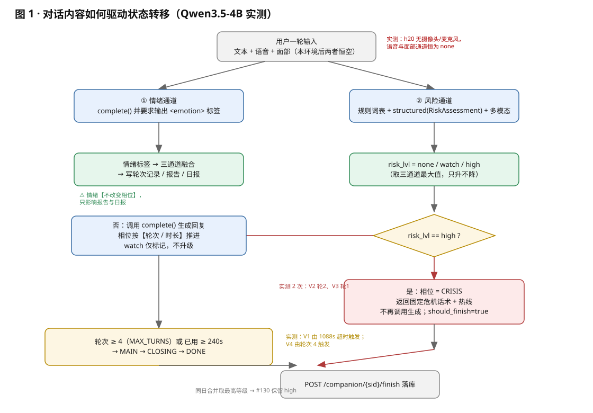
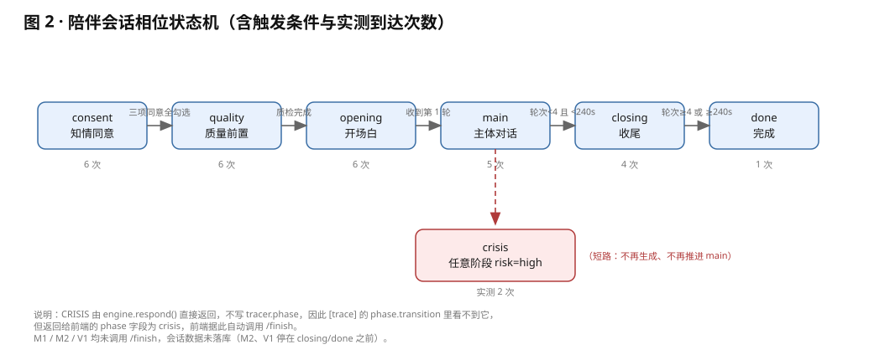
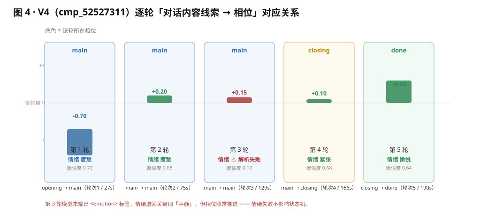
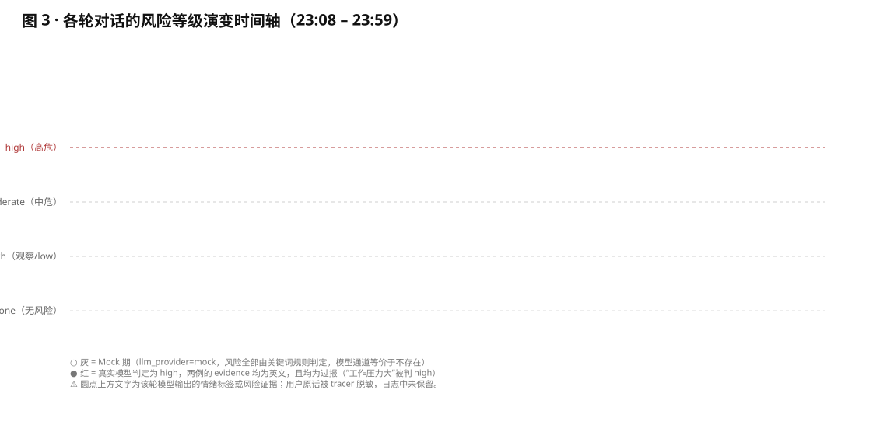

# MindTrace 陪伴会话复盘报告：对话内容 ↔ 状态转移

- 统计区间：2026-10-17 15:27 – 23:58（h20 / 29.77.193.107）
- 数据来源：`data/traces/agent-20261017.jsonl`、`/tmp/mt_backend.log`（`TRACE_ECHO=1` 回显）
- 模型分界：**23:29 后端以 `LLM_PROVIDER=vllm` 重启**，此前所有会话均为 MockLLM
- 配图：`figures/`（SVG，可用浏览器 / Typora / VS Code 打开；生成脚本 `figures/gen_figures.py`）

> ⚠ 关于"对话内容"的证据边界：陪伴会话的用户原话被 tracer 脱敏，**未落盘**。
> 本报告中的"内容线索"列只使用两类可证信息：① 模型输出的 `<emotion>` 情绪标签；② 风险通道回填的 `evidence` 原文片段（仅 2 轮有）。
> 其余标为「未留存」，可用文末命令从 `daily_record` 取回后补全。

---

## 一、核心机制：对话内容是如何变成状态转移的



**一句话结论：对话内容不直接驱动相位，它只驱动「情绪」和「风险」两件事；相位由风险等级 + 轮次/时长共同决定。**

| 输入 | 走向 | 是否改变相位 |
|---|---|---|
| 对话内容 → `complete()` + `<emotion>` | 情绪标签 → 三通道融合 → 轮次记录 / 报告 / 日报 | ❌ **不改变相位** |
| 对话内容 → 规则词表 + `structured(RiskAssessment)` + 多模态 | `risk_lvl` → `high` 时相位直接置 `CRISIS` | ✅ **唯一由内容驱动的状态跳转** |
| 轮次 `≥ MAX_TURNS(4)` 或 已用 `≥ WRAP_UP_AT(240s)` | `MAIN → CLOSING → DONE` | ✅ **与内容无关** |

三条实测印证：

1. **V4 第 3 轮**模型未输出 `<emotion>` 标签，情绪退回关键词「平静」，但相位照常 `main → main` —— 情绪失败对状态机零影响。
2. **V2 第 2 轮 / V3 第 1 轮**内容触发 `risk_lvl=high`，相位立刻短路到 `CRISIS`，**不再调用生成**、**不再推进 main**，前端收到 `should_finish=true` 后自动 `/finish`。
3. **V1 第 2 轮**相隔 18 分钟（已用 1088s）才发出，内容本身无风险，但相位因超时跳 `main → closing` —— 时间驱动而非内容驱动。

---

## 二、相位状态机与实测到达次数



| 相位 | 触发条件 | 实测到达 | 说明 |
|---|---|---|---|
| `consent` | 会话创建 | 6 / 6 | 三项同意全勾选才能进入下一相位 |
| `quality` | 三项同意确认 | 6 / 6 | V2 被前端重复 POST 两次（幂等，无副作用） |
| `opening` | 质检完成 | 6 / 6 | 本环境人脸/语音恒 False，走降级不阻断 |
| `main` | 收到第 1 轮 | 5 / 6 | V3 第 1 轮即危机，未进入 main |
| `closing` | 轮次 ≥ 4 或 已用 ≥ 240s | 4 / 6 | M2、V1 到此为止且未 `/finish` |
| `done` | closing 后再次发言 / 收尾 | 1 / 6 | 仅 V4 到达 |
| `crisis` | 任意阶段 `risk=high` | 2 / 6 | V2、V3；`engine` 直接返回，不写 `tracer.phase` |

---

## 三、逐轮「对话内容 → 状态转移」对照

### 阶段一：Mock 期（未调用任何模型）

#### M1（15:32:53 – 15:34:44）

| 轮次 | 时间 | 内容线索 | 内容原文 | 情绪 | 风险（规则/模型/多模态） | 相位转移 | 驱动因素 |
|---|---|---|---|---|---|---|---|
| 1 | 15:33:11 | 未留存 | 未留存 | 平静（关键词） | none / none / none | opening → main（轮次1 / 19s） | 轮次 |
| 2 | 15:33:41 | 未留存 | 未留存 | 平静 | none / none / none | main → main（轮次2 / 49s） | 轮次 |
| 3 | 15:34:13 | 未留存 | 未留存 | 平静 | none / none / none | main → main（轮次3 / 81s） | 轮次 |
| 4 | 15:34:44 | 未留存 | 未留存 | 平静 | none / none / none | main → closing（轮次4 / 112s） | 轮次达标 |

收尾：❌ 无 `/finish`，未落库。

#### M2（23:08:11 – 23:10:53，`cmp_49691582`，Carbonyl 首次成功会话）

| 轮次 | 时间 | 内容线索 | 内容原文 | 情绪 | 风险 | 相位转移 | 驱动因素 |
|---|---|---|---|---|---|---|---|
| 1 | 23:09:19 | 未留存 | 未留存 | 平静（关键词） | none / none / none | opening → main（轮次1 / 68s） | 轮次 |
| 2 | 23:10:03 | 未留存 | 未留存 | 平静 | none / none / none | main → main（轮次2 / 112s） | 轮次 |
| 3 | 23:10:29 | 未留存 | 未留存 | 平静 | none / none / none | main → main（轮次3 / 138s） | 轮次 |
| 4 | 23:10:53 | 未留存 | 未留存 | 平静 | none / none / none | main → closing（轮次4 / 162s） | 轮次达标 |

收尾：❌ 无 `/finish`（中途切到审核台 / 事件轨迹页），未落库。

### 阶段二：真模型期（vLLM `Qwen3.5-4B`）

#### V1（23:29:09 – 23:47:17，`cmp_50949582`）

| 轮次 | 时间 | 内容线索（模型输出） | 内容原文 | 情绪 | 风险 | 相位转移 | 驱动因素 |
|---|---|---|---|---|---|---|---|
| 1 | 23:29:51 | 模型判「惊讶」 | 未留存 | **惊讶** v+0.00 a+0.10 conf 0.48 | none / none / none | opening → main（轮次1 / 44s） | 轮次 |
| 2 | 23:47:16 | ⚠ 未拿到 `<emotion>`，退回关键词 | 未留存 | 平静（兜底） | none / none / none | main → closing（轮次2 / **1088s**） | **超时（≥240s）** |

收尾：❌ 无 `/finish`。**这是"时间驱动而非内容驱动"最典型的一例**：第 2 轮内容无风险，仅因距开场 18 分钟就被收尾。

#### V2（23:49:15 – 23:50:30，`cmp_52155908`）

| 轮次 | 时间 | 内容线索（模型输出） | 内容原文 | 情绪 | 风险 | 相位转移 | 驱动因素 |
|---|---|---|---|---|---|---|---|
| 1 | 23:49:57 | 模型判「疲惫」 | 未留存 | **疲惫** v-0.70 a+0.10 conf 0.72 | none / **watch(low)** / none | opening → main（轮次1 / 43s） | 轮次（low 按设计不升级） |
| 2 | 23:50:28 | 模型 evidence：`I simply don't have the energy to…` | 未留存（英文输入） | —（短路，不生成） | none / **high** / **未评估** | **→ CRISIS**（无相位推进记录） | **内容触发 high** |

收尾：✅ `finish` 23:50:30 → 每日记录 `#130`，风险 **high**，轮次 2，抽取事实 0 条。

#### V3（23:51:53 – 23:53:59，`cmp_52313753`）

| 轮次 | 时间 | 内容线索（模型输出） | 内容原文 | 情绪 | 风险 | 相位转移 | 驱动因素 |
|---|---|---|---|---|---|---|---|
| 1 | 23:53:57 | 模型 evidence：`Work has been pretty stressful la…` | 未留存（英文输入） | —（短路，不生成） | none / **high** / **未评估** | **→ CRISIS**（未进入 main） | **内容触发 high** |

收尾：✅ `finish` 23:53:59 → `#130` 风险 **high**，轮次 1，抽取事实 2 条。

> ⚠ **过报**：「Work has been pretty stressful lately（工作压力挺大）」被判 `high`，属明显误报，直接触发危机话术 + 热线。

#### V4（23:55:27 – 23:58:37，`cmp_52527311`，最完整的一次）



| 轮次 | 时间 | 内容线索（模型输出） | 内容原文 | 情绪 | 风险 | 相位转移 | 驱动因素 |
|---|---|---|---|---|---|---|---|
| 1 | 23:55:52 | 模型判「疲惫」 | 未留存 | **疲惫** v-0.70 a+0.10 conf 0.72 | none / none / none | opening → main（轮次1 / 27s） | 轮次 |
| 2 | 23:56:40 | 模型判「疲惫」，愉悦度回升 | 未留存 | **疲惫** v+0.20 a+0.15 conf 0.68 | none / none / none | main → main（轮次2 / 75s） | 轮次 |
| 3 | 23:57:35 | ⚠ 标签解析失败 → 平静 | 未留存 | 平静（兜底） | none / none / none | main → main（轮次3 / 129s） | 轮次（情绪失败不影响相位） |
| 4 | 23:58:11 | 模型判「紧张」，唤醒度升高 | 未留存 | **紧张** v+0.10 a+0.30 conf 0.68 | none / none / none | main → **closing**（轮次4 / 166s） | **轮次达标（MAX_TURNS=4）** |
| 5 | 23:58:34 | 模型判「愉悦」，明显好转 | 未留存 | **愉悦** v+0.60 a+0.15 conf 0.64 | none / none / none | closing → **done**（轮次5 / 190s） | 收尾相位自然推进 |

收尾：✅ `finish` 23:58:37 → `#130` 风险 none（同日合并取最高，日报仍为 high），轮次 5，抽取事实 3 条，情绪基线 v=0.23 a=0.11。

---

## 四、风险演变时间轴



| 阶段 | 陪伴轮次 | none | watch(low) | high |
|---|---|---|---|---|
| Mock 期 | 8 | 8 | 0 | 0 |
| 真模型期 | 10 | 7 | 1 | **2** |
| 合计 | 18 | 15 | 1 | 2 |

- 两次 `high` **全部由模型语义通道单独触发**，规则通道均为 none。
- `watch(low)` 按设计不参与升级（`levels` 仅在 `model_lvl ≥ 2` 时追加），故 V2 第 1 轮整体仍为 none。
- 同日 3 次 `finish` 均写 `#130`；`daily_bridge.py:313` 按 `_LEVEL_ORDER`（none0 / watch1 / low1 / moderate2 / high3 / imminent4）取最高 → **high 未被后续 none 覆盖**，符合"只升不降"红线。

---

## 五、LLM 调用统计

| 会话 | 轮次 | 风险分级 `structured` | 生成回复 `complete` | 备注 |
|---|---|---|---|---|
| V1 | 2 | 2 / 2 ✅ | 2 次尝试，1 次解析到标签 | 第 2 轮标签缺失 |
| V2 | 2 | 2 / 2 ✅ | 1 次（第 2 轮危机短路） | 短路是设计红线 |
| V3 | 1 | 1 / 1 ✅ | 0 次（危机短路） | — |
| V4 | 5 | 5 / 5 ✅ | 5 次尝试，4 次成功 | 第 3 轮标签缺失 |
| **合计** | **10** | **10 / 10** | **8 次尝试 / 6 次成功（75%）** | 另有 3 次收尾事实抽取 |

结论：**风险分级每轮必调（10/10）；生成回复在命中 high 的 2 轮被短路。**

---

## 六、结论

✅ **符合预期**：LLM 链路打通，无静默回落 mock；相位机流转正确；危机短路生效；`/finish` 落库成功；同日风险只升不降；多模态降级不阻断会话。

⚠ **偏差**：

| 优先级 | 问题 | 证据 |
|---|---|---|
| P0 | 主聊天（CBT）路径整条 500 | `POST /api/sessions` 4 次 500，`ModuleNotFoundError: No module named 'langgraph'`（`requirements.txt` 已声明未安装） |
| P0 | **风险过报** | 「Work has been pretty stressful lately」→ `high` |
| P1 | 中文输入未解决 → 全程英文在测 | 两处 evidence 均为英文片段 |
| P1 | `<emotion>` 解析失败率 25% | 8 次尝试 2 次缺失（V1 轮2、V4 轮3） |
| P2 | 两次会话未收尾（M2、V1）→ 未落库 | 日志无 `/finish` |
| P2 | `quality` 重复提交 | 23:49:32.656 / .936 两次 |
| P2 | 审核台看不到观察级风险 | `persist_risk` 将 `watch` 落为 `level="low"`，审核台默认 `min_level=2` |
| P3 | 语音不可用（架构性） | 麦克风在 Mac、浏览器在 h20，`getUserMedia` 物理不可达 |

---

## 七、补全"对话内容原文"的方法

陪伴会话原话未进 trace，但收尾时写进了 `daily_record` 的叙述字段，可在 h20 上取回后填回本表：

```bash
curl -s 'http://127.0.0.1:8000/api/daily/u_demo?limit=5' \
  | python3 -c "import sys,json;[print(json.dumps(r,ensure_ascii=False,indent=2)) for r in json.load(sys.stdin)]"

# 画像事实（模型抽取的 3 条事实）
curl -s 'http://127.0.0.1:8000/api/overview/u_demo' \
  | python3 -c "import sys,json;d=json.load(sys.stdin);print(d['profile']);print(d['risk_flags'])"
```

## 八、待办

| 优先级 | 动作 |
|---|---|
| P0 | `pip install --proxy http://star-proxy.oa.com:3128 -r backend/requirements.txt` 后重启后端 |
| P0 | 开 `VLLM_THINKING_FOR_ASSESS=1` + `VLLM_MAX_TOKENS=1536` 重启，重跑同一批句子对比；建立 10–20 句分级回归集量化混淆矩阵 |
| P1 | 解决中文输入（粘贴 / `mt_demo.py` 脚本），补中文场景回归 |
| P1 | prompt 中要求"证据必须引用用户原话原文"，提升审核台可读性 |
| P2 | 修 `quality` 重复提交；演示务必点「结束并查看小结」 |
| P3 | iOA 开通后用 Mac 浏览器访问 `8443`（HTTPS）才能启用摄像头/麦克风 |
